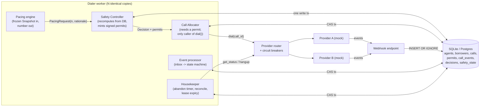
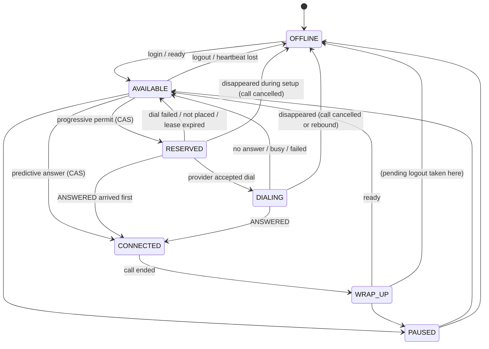
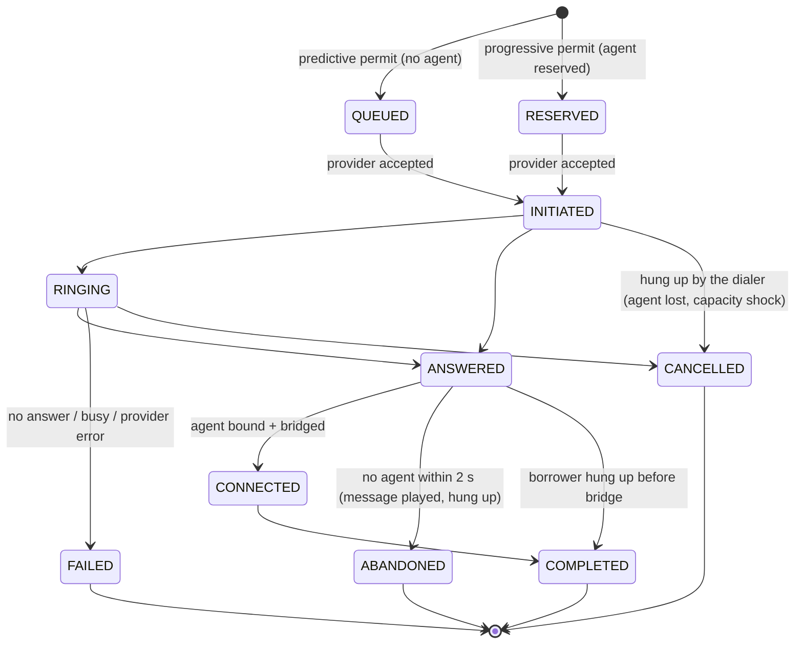

# SmartDialer

An outbound collections dialer with progressive and predictive pacing. The predictive
algorithm never places a call directly: every call needs a single-use permit from an
independent Safety Controller, which allocates from one budget shared by all workers.


**Contents:** [Overview](#overview) · [Quick start](#quick-start) · [Repository layout](#repository-layout) · [Architecture](#architecture) · [State machines](#state-machines) · [Concurrency model](#concurrency-model) · [Call flows](#call-flows) · [Providers and events](#providers-and-events) · [Failure handling](#failure-handling-and-recovery) · [Pacing and safety](#pacing-and-safety) · [Simulation](#simulation) · [Performance and scaling](#performance-and-scaling) · [Architecture decisions](#architecture-decisions) · [Limitations](#known-limitations) · [Roadmap](#roadmap)

## Overview

| Property | How it is achieved |
|---|---|
| One agent, one live call; one borrower, one live call | Conditional (compare-and-set) updates inside write transactions, backed by partial unique indexes in the database |
| Pacing cannot bypass safety | The pacer only returns a number; dialing requires an HMAC-signed, single-use, 3-second permit minted by the Safety Controller |
| Bounded abandon rate | Deterministic floor (progressive), pessimistic statistical bound for predictive, rolling abandon-rate breaker that forces progressive |
| Calling hours | Safety rejects every request outside 08:00-19:00 local, and no permit outlives the window |
| Correct under hostile providers | Webhook inbox with dedupe, monotonic state machine, timeouts treated as "unknown" and reconciled with the provider |
| Crash recovery without coordination | Work is owned through leases; any worker recovers expired work, and compare-and-set lets exactly one succeed |

Simulated results, 100 agents, 20 minutes ([docs/RESULTS.md](docs/RESULTS.md)):

| Answer rate / talk time | Progressive busy | Predictive busy | Abandon rate |
|---|---|---|---|
| 20% / 120 s | 56.5% | 82.8% | 0% |
| 50% / 90 s | 75.7% | 83.2% | 0% |
| 70% / 180 s | 90.4% | 91.8% | 0% |
| changing | 64.5% | 80.5% | 0% |

No double allocation or invariant violation in any scenario run, the 60 tests, or ~100k
contended allocations in the load test.

## Quick start

Python 3.10+. The dialer uses the standard library only; pytest for tests, matplotlib for charts.

```bash
python -m venv .venv && source .venv/bin/activate   # Windows: .venv\Scripts\activate
pip install -r requirements.txt

python -m pytest -q                 # 60 tests, ~10 s
python -m sim.run                   # all 19 scenarios, 2-5 min -> docs/RESULTS.md, docs/results/*, dashboard
python -m sim.run --quick           # 10-minute scenarios
python -m sim.run --only F3         # one scenario (prefix match); updates its row and the dashboard
python -m sim.sweep                 # answer-rate x talk-time grid + segment runs, ~4 min -> docs/SWEEP.md
python -m loadtest.load_test        # ~1-2 min -> docs/LOAD.md
python -m sim.dashboard             # rebuild docs/dashboard.html from existing results
```

`docs/dashboard.html` is a static page (no server): agent states over time, pacer requests
against safety approvals, and every safety decision with its reason. Clicking a chart jumps the
decision log to that second. Raw decisions are in `docs/results/<scenario>.decisions.jsonl`.

## Repository layout

```
smartdialer/
  models.py       agent + call state machines, event resolution (pure functions)
  db.py           schema, write transactions (BEGIN IMMEDIATE), unique-index invariants,
                  trigger-maintained state counters
  repo.py         compare-and-set primitives: reserve agent, claim borrower, transitions
  ledger.py       snapshot / statistics read model
  pacing.py       ProgressivePacer, PredictivePacer (no access to DB, provider or safety)
  stats.py        answer-rate bounds and the binomial overflow model, shared by pacer and safety
  safety.py       SafetyController (gates, overflow bound, permits), PermitVerifier
  allocator.py    CallAllocator: the only caller of provider.dial()
  events.py       webhook inbox + exactly-once processing
  recovery.py     abandon timer, crash recovery, reconciliation, lease expiry, retention
  health.py       circuit breaker + provider router
  worker.py       worker loop
  invariants.py   cross-table invariants checked by tests and the simulator
  providers/      provider interface; mock providers A (fast, reliable) and B (slow, timeouts,
                  duplicates, reordering), outage switch
sim/              virtual-clock simulator driving the real code; scenario runner;
                  sweep.py (answer-rate x talk-time grid, clustered borrower segments);
                  dashboard.py + dashboard.html (template) build docs/dashboard.html
loadtest/         contention, decision-cost and event-throughput benchmarks
tests/            state machines, races, events, crash recovery, safety, allocator, end-to-end
docs/             ARCHITECTURE_DECISIONS.md, workflow.svg, RESULTS.md, SWEEP.md, LOAD.md, dashboard.html,
                  results/
```

## Architecture

### Components

| Component | File | Responsibility |
|---|---|---|
| Pacing engine | `pacing.py` | Reads a frozen `Snapshot`, returns a `PacingRequest(mode, calls, rationale)` |
| Safety Controller | `safety.py` | Recomputes capacity from the database, applies gates and the overflow bound, mints permits, records every decision |
| Call Allocator | `allocator.py` | Consumes one permit per call, reserves agent and borrower, dials through the router |
| Provider router | `health.py` | Picks a provider whose circuit breaker admits calls; failover in priority order |
| Event processor | `events.py` | Stores webhooks in the inbox, applies each event once through the state machine |
| Housekeeper | `recovery.py` | 2 s abandon timer, bridge retries, crash and timeout reconciliation, lease expiry, agent presence |
| Database | `db.py`, `repo.py` | Single source of truth; all shared decisions are conditional writes |



```
Campaign -> Pacing Engine -> Safety Controller -> Call Allocator -> Provider Router -> Telecom Provider
              (asks)          (decides, mints      (consumes one       (breaker per
                               permits)             permit per call)    provider)
                                    \___________ all state in one DB ___________/
                                                        ^
                       Provider webhooks -> inbox table -+-> Event processor
```

There is no queue, cache or coordinator service. Every worker runs the same loop, and every
shared decision is a conditional write in the database.

### Worker loop (`worker.py`)

```
every ~0.5 s   service(): process inbox events, bind waiting answered calls, run the 2 s
                          abandon timer, execute pending hang-ups
every 1 s      pace():    housekeeping -> snapshot -> pacer.request() -> safety.evaluate()
                          -> cancel excess (if instructed) -> allocator.execute(permits)
```

The fast loop protects calls that are already answered; the slow loop decides new dials.

### Data model (`db.py`)

| Table | Holds | Key columns |
|---|---|---|
| `agents` | Agent state and binding | `state`, `call_id`, `lease_owner`, `lease_until`, `state_since`, `last_heartbeat`, `pending_offline` |
| `borrowers` | Dial queue | `status`, `priority`, `attempts`, `max_attempts`, `provider_failures`, `next_attempt_at`, `progressive_only`, `last_call_id` |
| `calls` | One row per call attempt | `state`, `mode`, `agent_id`, `provider`, `permit_id` (unique), `owner`, `lease_until`, `dial_uncertain`, `cancel_requested`, timestamps, `net_outcome` |
| `call_events` | Webhook inbox | `UNIQUE(provider, event_id)`, `processed`, `outcome` |
| `permits` | Issued dial permits | `mode`, `expires_at`, `sig`, `consumed_by`, `revoked` |
| `decisions` | Audit log of every safety decision | requested, approved, verdict, reasons, numbers (pacer rationale + safety inputs) |
| `safety_state` | Abandon breaker shared by all workers | `forced_progressive`, `forced_since` |
| `agent_counts`, `call_counts` | Running counts of agents per state and calls per (state, has agent) | maintained by triggers on `agents` and `calls` in the same transaction as each change |
| `workers` | Worker heartbeats | `heartbeat` |

Retention: permits that were used or expired are deleted after 10 minutes and processed inbox
events after 1 hour (`Housekeeper.prune`, once a minute, in batches). The `decisions` table is
kept as the audit trail.

Partial unique indexes on `calls(agent_id)` and `calls(borrower_id)` over non-terminal states
enforce one live call per agent and per borrower, independently of application code.

## State machines

### Agent



`agents.call_id` references the bound call. A CONNECTED agent who logs out is marked
`pending_offline=1` and goes offline at wrap-up; a live conversation is never interrupted.
An agent who disappears during setup is detached from the call: an unanswered call is hung up
and the borrower requeued without penalty; an already answered call is rebound to any free
agent within the 2 s grace.

### Call



Pre-dial states (QUEUED, RESERVED) accept any later state from a provider event, since an event
proves the dial happened. This is what lets a call heal after a worker crashes between dialing
and recording the dial.

### Event resolution (`models.resolve_event`)

| Rule | Behaviour |
|---|---|
| Monotonic rank | QUEUED 0 < RESERVED 1 < INITIATED 2 < RINGING 3 < ANSWERED 4 < CONNECTED 5 < terminal 9. An event implying a lower rank is `stale` |
| Terminal absorbs | After COMPLETED / FAILED / CANCELLED / ABANDONED every event is `after_terminal` |
| Same state | `duplicate`, no transition |
| Facts kept | A late ANSWERED still sets `net_outcome='ANSWER'` so answer-rate statistics stay correct |
| Timestamps capped | Event times are capped at our receipt time, so a provider clock running ahead cannot stretch the 2 s abandon timer |
| COMPLETED in context | `answered=true`, or a call already ANSWERED/CONNECTED, means COMPLETED; otherwise FAILED (no answer) |

| Event sequence | Outcome |
|---|---|
| ANSWERED, ANSWERED, ANSWERED, COMPLETED | applied, duplicate, duplicate, applied; one bridge |
| COMPLETED, ANSWERED, RINGING | applied, after_terminal, after_terminal; answer recorded |
| Any permutation of RINGING / ANSWERED / COMPLETED plus a duplicate | Always COMPLETED (exhaustively tested) |

## Concurrency model

### Atomic agent reservation (`repo.reserve_agent`)

```sql
UPDATE agents SET state='RESERVED', call_id=?, lease_owner=?, lease_until=?, version=version+1
WHERE id = (SELECT id FROM agents WHERE state='AVAILABLE' ORDER BY state_since, id LIMIT 1)
  AND state='AVAILABLE'
RETURNING id
```

* `BEGIN IMMEDIATE` takes the write lock before reading, so the read and write of one worker
  cannot interleave with another's. A concurrent worker waits, re-runs the subquery, and gets
  the next agent or none.
* `AND state='AVAILABLE'` is the compare-and-set. Under Postgres READ COMMITTED the second
  UPDATE re-checks the row after the first commits and matches zero rows. On Postgres,
  `FOR UPDATE SKIP LOCKED` in the subquery lets workers take different agents instead of
  queueing on the same row.
* Borrower claims (`repo.claim_borrower`) use the same pattern, ordered by
  `progressive_only DESC, priority DESC, next_attempt_at` through a matching index.
* The database is the source of truth. No reservation, binding or permit decision reads a
  cache; a cache added for dashboards or candidate pre-filtering would be advisory only.

Covered by `test_two_threads_same_agent` (30 two-thread barrier races),
`test_many_processes_never_double_allocate` (6 processes, 50 agents, 60 borrowers),
`test_database_backstop_rejects_second_active_call_per_agent` and `test_stale_cas_loses`.

### Multiple workers on one campaign

| Concern | Mechanism |
|---|---|
| Agent allocation | CAS reserve in a write transaction + unique index |
| Borrower allocation | CAS claim with lease + unique index; `settle_borrower` guarded on `last_call_id`, so a late outcome for an old call cannot affect a newer attempt |
| Pacing overshoot across workers | Safety counts unconsumed, unexpired permits from all workers as in flight, inside its write transaction (`test_concurrent_workers_share_one_budget`, sim F5) |
| Duplicate jobs / retries | Permits single-use; `calls.permit_id` unique; dial idempotent on `call_id` |
| Concurrent updates | Every mutation is `UPDATE ... WHERE state IN (expected)` with a rowcount check |
| Worker crashes | Leases on calls, agents and borrowers; any housekeeper recovers expired work after asking the provider |
| Stale state | Pacer input may be stale; safety reads fresh under the write lock; permits expire in 3 s; requests older than 2 s are rejected |
| Provider events | Shared inbox; any worker processes any event; one transaction per event |

Circuit breakers are in memory per worker; each worker detects an outage from its own failures
within a few calls.

## Call flows

### Progressive

```
safety: prog_cap = free_agents - unbacked_in_flight - open_permits        (deterministic)
allocator, one tx:  consume permit (CAS) -> reserve agent (CAS) -> claim borrower (CAS)
                    -> insert call RESERVED with lease (owner = worker, 10 s)
dial(call_id)       call_id doubles as idempotency key
  ok        tx: call -> INITIATED, agent RESERVED -> DIALING (CAS on agent.call_id);
            if the agent CAS fails the agent left during setup -> cancel, requeue without penalty
  timeout   outcome unknown: keep agent + borrower, mark dial_uncertain, lease = now + 3 s;
            housekeeper asks get_status(call_id): known -> adopt, unknown -> FAILED + backoff
  error     tx: call FAILED, agent AVAILABLE, borrower provider backoff (not an attempt)
ANSWERED    tx: agent DIALING -> CONNECTED, call -> CONNECTED; bridge after commit
```

Borrower order: `progressive_only` first, then `priority`, then earliest `next_attempt_at`.
Agent order: longest idle (`state_since`). The agent is reserved in the same transaction that
consumes the permit and claims the borrower, before any network call.

### Predictive

The permit is PREDICTIVE: no agent is reserved and the call is QUEUED/INITIATED with
`agent_id NULL` (unbacked). On ANSWERED the event transaction binds the longest-idle AVAILABLE
agent directly to CONNECTED. Without a free agent the call waits in ANSWERED and every service
tick retries in answer order; after 2 s it becomes ABANDONED, a compliance message is played
through hang-up, and the borrower is flagged `progressive_only` so the next attempt has an agent
reserved.

### Borrower retry policy (`repo.settle_borrower`)

| Outcome | Next attempt |
|---|---|
| No answer / busy / hung up before bridge | +5 min, counts as an attempt (max 3, then EXHAUSTED) |
| Abandoned | +10 min, counts as an attempt, `progressive_only=1` |
| Provider failure | Exponential backoff with jitter (5 s, 10 s, 20 s ... cap 300 s), not an attempt |
| Cancelled by the dialer / not dialed | +1 s, not an attempt |
| Connected | DONE |

## Providers and events

### Provider interface (`providers/base.py`)

`dial(call_id, phone)`, `hangup(call_id)`, `bridge(call_id, agent_id)`, `get_status(call_id)`,
plus events pushed to a sink (the webhook handler). `call_id` is the idempotency key.
`ProviderTimeout` means outcome unknown; `ProviderError` means definitely rejected.

| Mock | Setup to ring | Webhook delay | Rejects | Timeouts | Duplicates | Reordering |
|---|---|---|---|---|---|---|
| A | 0.5-1.5 s | 20-150 ms | 0.5% | 0.2% | none | none |
| B | 2-5 s | 0.2-0.9 s, 15% +0.5-2.5 s | 3% | 5% (half still placed) | 15% same id, 3% new id | yes |

Both support an outage switch: dials, status and hang-ups time out and webhooks are held until
recovery, while calls already in the network continue.

### Inbox and exactly-once processing (`events.py`)

* Webhook handler: `INSERT OR IGNORE INTO call_events ... UNIQUE(provider, event_id)`. Exact
  redeliveries are dropped here; the handler acknowledges only after commit.
* Processing is one transaction: claim the event (`UPDATE ... SET processed=1 WHERE processed=0`),
  then apply the transition and all side effects (agent bind/release, borrower outcome). A crash
  rolls everything back and the event stays available to any worker.
* The only external side effect, `provider.bridge()`, runs after commit and is idempotent. If it
  fails, `calls.bridged_at` stays NULL and the housekeeper retries it.

### Health and routing (`health.py`)

Per-provider circuit breaker: opens after 3 consecutive timeouts or a 50% failure rate over the
last 20 attempts (minimum 5); half-open after 10 s with 2 probe dials; closes on success. The
router tries providers in priority order. Safety rejects all new dials while no breaker admits
calls, and caps approvals at the probe count while half-open.

### Real provider adapter (not built)

A Plivo adapter fits the same interface: `dial()` maps to the Call API with `call_id` in the
answer URL / custom headers; the webhook handler maps `CallStatus` (`ringing`, `in-progress`,
`completed`, `busy`, `no-answer`, `failed`) onto RINGING / ANSWERED / COMPLETED / FAILED with the
request UUID + status as `event_id`; `get_status()` maps to the call-detail lookup; `bridge()`
is a conference/transfer to the agent leg.

## Failure handling and recovery

| Case | Behaviour | Code / test |
|---|---|---|
| Worker crash after reserve, before dial | Call stays RESERVED with a 10 s lease; after expiry a housekeeper sees `provider IS NULL` -> FAILED `not_dialed`, agent AVAILABLE, borrower requeued without an attempt | `recovery.reconcile_predial`, `test_worker_crash_before_dial_releases_everything` |
| Worker crash after dial, before recording | Provider events move the call forward from the inbox; without events, after the lease the housekeeper calls `get_status(call_id)` and adopts the call (INITIATED, agent DIALING) | `test_worker_crash_after_dial_is_adopted`, sim F4 |
| Worker crash after dial, events lost, provider reports the call already ended | Housekeeper closes it as FAILED `ended_unseen`, frees the reserved agent, requeues the borrower with provider backoff; late events are ignored apart from facts | `test_crash_after_dial_and_call_already_ended_frees_agent` |
| Worker crash while processing an event | Transaction rolls back; event stays unprocessed for another worker | `test_crash_inside_answered_processing_then_completed` |
| Crash after ANSWERED committed, before bridge | CONNECTED with `bridged_at NULL`; housekeeper retries the bridge | `test_crash_after_answered_commit_before_bridge` |
| Dial timeout | Agent and borrower held; reconcile via `get_status` after 3 s; after 30 s unreachable, best-effort hang-up and FAILED `provider_lost` | `test_dial_timeout_*`, `test_provider_unreachable_during_reconcile_gives_up_eventually` |
| Provider outage, new dials | Breaker opens; safety rejects; half-open probes; failover to the next provider | `health.py`, sim F2 / F2b |
| Provider outage, calls in progress | Left alone; webhooks arrive late. No event for 90 s -> `get_status`; unreachable for 3x that -> hang-up and FAILED so agents are released | `recovery.reconcile_stale` |
| Provider failures and statistics | Not network outcomes, excluded from the answer-rate window, so an outage does not read as "nobody answers" | `ledger.read_snapshot` |
| Agents disappear (40 of 100) | Next decision (<= 1 s) sees `recently_left`, recomputes the bound, revokes unused permits, cancels excess unbacked calls (not yet ringing first), approves 0 until in flight drains | `test_agent_drop_cancels_excess_ringing`, sim F3 |
| Duplicate events | Exact: dropped at the inbox. New id: `duplicate` / `stale` no-op | sim F1 |
| Out-of-order events | Monotonic rank + terminal absorption | `test_every_ordering_of_a_normal_call_converges` |
| Provider clock ahead of ours | Event times capped at receipt time; abandon timer measured from the earlier of the two | `test_provider_clock_ahead_does_not_stretch_abandon_timer` |
| Stale agent presence | Heartbeat older than 15 s: not counted as free by safety; logged out by the housekeeper | `recovery.agent_presence` |

## Pacing and safety

### Safety model

Predictive dialing runs as a bounded overdraft on top of progressive:

1. **Progressive is the floor.** Only agents free now are counted and every unbacked ringing
   call is treated as a certain answer, so the worst case is zero abandons. Used at cold start,
   when the breaker trips, and for borrowers flagged `progressive_only`.
2. **Overdial is a budget owned by the Safety Controller.** The pacer only requests. Safety
   decides how many unbacked calls may exist, from a fresh read and a pessimistic answer rate,
   and issues single-use permits from one ledger shared by every worker.
3. **Model-independent bounds.** Dial-ratio ceiling, provider-health gating, freshness checks,
   and a rolling abandon-rate breaker that returns all workers to progressive before the
   regulatory limit. When the statistical layer is wrong, damage is limited to calls already in
   flight.
4. **Deterministic answer path.** An answered call claims a free agent atomically or waits a
   fixed 2 s grace, then receives a compliance message and an agent-reserved retry.

### Pacing engine vs Safety Controller

| | Pacing engine | Safety Controller |
|---|---|---|
| Computes | Calls in flight that keep agents busy at the expected answer rate | Calls allowed in flight |
| Model | Binomial overflow bound (`stats.py`) | Same model |
| Inputs | Frozen `Snapshot` (up to 2 s old) | Fresh read inside its own write transaction |
| Answer rate | Expected value (Beta prior + window) | Upper confidence bound |
| Abandon target | 3% (regulatory limit) | 1.5%, shrinking toward 0 as the rolling rate rises |
| Agents counted | Free now, not promised to a call | Same, plus fresh heartbeat required |
| Dial-ratio ceiling | Read from the snapshot (`max_dial_ratio`, published from `SafetyConfig`) | `SafetyConfig.max_dial_ratio` = 4 x free agents |
| Output | A number + rationale | Signed single-use permits + verdict + reasons |

Because both sides use the same model on the same agents, the pacer always asks for at least
what safety allows, and the difference between the two is exactly the cost of the safety margin
(pessimistic answer rate, tighter abandon target).

### Predictive pacer (`pacing.py`)

```
p          = (prior_p*w + answers_long + answers_short) / (w + n_long + n_short)    (short window weighted 2x)
             raised to the answers already seen among calls dialed in the last 30 s
C          = AVAILABLE - stale heartbeats - answered_waiting - open progressive permits
in_flight  = unbacked calls ringing + unconsumed predictive permits
target m   = largest m <= max_dial_ratio*C with E[(X - C)+] <= 3% * E[min(X, C)],  X ~ Binomial(m, p)
request    = floor( aggressiveness * (m - in_flight) )
```

Answer-rate statistics use resolved dial cohorts: calls dialed more than 30 s ago, so every
outcome is known. Ordering by outcome time instead is biased toward answers, which resolve in
~8 s against ~25 s for no-answers.

### Safety gates (`safety.py`)

Evaluated in order inside one `BEGIN IMMEDIATE` transaction:

| # | Gate | Kind | Effect |
|---|---|---|---|
| 1 | Rolling abandon rate (15 min) >= 2.5% (cap 3%) | deterministic | Force PROGRESSIVE for all workers until <= 1.0% and >= 60 s cooldown |
| 2 | Request based on a snapshot older than 2 s | deterministic | REJECT |
| 2b | Outside the calling window (08:00-19:00 local, `SafetyConfig.calling_window`) | deterministic | REJECT; permits issued near closing expire at closing |
| 3 | No provider breaker admits calls | deterministic | REJECT; half-open caps at probe count |
| 4 | Fewer than 40 resolved outcomes | deterministic | FALLBACK to progressive |
| 5 | Agent heartbeat stale | deterministic | Not counted as free |
| 6 | Capacity shock (>= 5% of agents left in 30 s, or answer-rate shift) with unbacked calls above the bound | statistical | Revoke unused permits, cancel excess calls, not yet ringing first |
| 7 | Unbacked in flight <= 4 x free agents; <= provider concurrency | deterministic | REDUCE |
| 8 | Overflow bound | statistical | REDUCE / REJECT |

Progressive approval is `free_agents - unbacked_in_flight - open_permits`. Borrowers flagged
`progressive_only` receive agent-reserved permits first, also in predictive mode.

### Overflow bound

`C` = agents AVAILABLE now and unclaimed, `m` = unbacked calls in flight after the decision,
`X ~ Binomial(m, p_hi)`:

```
E[abandon]  = E[(X - C)+]
E[connect]  = E[min(X, C)]
approve the largest m with   E[abandon] <= eps * E[connect]
```

* `p_hi`: Wilson upper bound (one-sided 95%) on the last 400 resolved outcomes. A 40-outcome
  window overrides it only when its lower bound exceeds the long upper bound (regime shift).
  Answers already seen among calls dialed in the last 30 s act as a floor.
* `eps` = 1.5%, shrinking to 0 as the rolling abandon rate approaches the 2.5% trip.
* The model assumes all ringing calls could answer at once against today's free agents and no
  agent frees meanwhile. Both assumptions err on the safe side.

### Permit enforcement

1. The pacer is constructed without a database handle, router, allocator or `SafetyConfig`.
2. `provider.dial()` is called only in `CallAllocator._dial`, reached only through `place(permit)`.
3. `place()` requires a permit with a valid HMAC, unexpired (3 s, or the end of the calling
   window if sooner), and atomically consumed in
   the transaction that reserves agent and borrower. Reused, forged, mode-tampered and expired
   permits are refused.
4. `SafetyConfig` is a frozen dataclass set at start-up.

A production deployment would run the Safety Controller and allocator as the only process
holding provider credentials.

### Decision record

Every decision is stored in `decisions` (and `docs/results/*.decisions.jsonl`) with the
pacer's rationale and the safety inputs. Example, scenario B at t = 401 s:

* 20 agents free, 25 unbacked calls already ringing.
* Pacer: expected answer rate p = 0.52, target 3%.
* Safety: upper-bound answer rate p_hi = 0.568, target 1.5%.

Expected abandons as a share of expected connects, for m calls in flight:

| Total in flight m | Pacer (p = 0.52) | Safety (p_hi = 0.568) |
|---|---|---|
| 25 (current) | 0.01% | 0.04% |
| 30 | 0.36% | **1.05%** (largest under 1.5%) |
| 31 | 0.60% | 1.63% |
| 35 | **2.72%** (largest under 3%) | 5.88% |
| 36 | 3.62% | 7.46% |

Pacer target m = 35, so it requests 35 - 25 = **10**. Safety's bound is m = 30, so it issues
**5** permits. Verdict REDUCED, reason
`overflow bound: p_hi=0.568, eps=1.500% allows 30 in flight for 20 agents`.

## Simulation

The simulator (`sim/simulator.py`) drives the real worker, safety, allocator, event and recovery
code with the mock providers on a virtual clock; 20 simulated minutes run in ~15 s and are
reproducible from a seed (call, permit and decision ids come from a seeded generator, so ties on
equal timestamps break the same way every run; production uses `uuid4`). Simulated time 0 is
10:00 local. The mock borrower population models answer rate (fixed, changing over time, or per
borrower segment), 3-12 s ring-to-answer, 25 s no-answer timeout, 15% busy share among
non-answers, 3-8 s patience on silence, and gamma-distributed talk time.

### Scenarios (100 agents, provider A, 20 minutes)

| Scenario | Mode | Busy | Calls initiated | Calls connected | Pacer request / safety approval (mean per decision) | Safety verdicts (approved / reduced / rejected / progressive) | Abandoned |
|---|---|---|---|---|---|---|---|
| A: 20%, 120 s | progressive | 56.5% | 2,708 | 532 | 2.2 / 2.2 | all approved | 0 |
| | predictive | 82.8% | 3,920 | 780 | 10.4 / 3.1 | 336 / 525 / 309 / 31 | 0 |
| B: 50%, 90 s | progressive | 75.7% | 1,889 | 924 | 1.5 / 1.5 | all approved | 0 |
| | predictive | 83.2% | 2,053 | 1,028 | 5.3 / 1.6 | 74 / 721 / 375 / 31 | 0 |
| C: 70%, 180 s | progressive | 90.4% | 940 | 636 | 0.7 / 0.7 | all approved | 0 |
| | predictive | 91.8% | 934 | 655 | 1.6 / 0.7 | 324 / 450 / 396 / 31 | 0 |
| D: 20% -> 70% -> 10%, 120 -> 180 -> 90 s | progressive | 64.5% | 2,347 | 534 | 1.8 / 1.8 | all approved | 0 |
| | predictive | 80.5% | 3,818 | 694 | 8.5 / 3.0 | 411 / 473 / 286 / 31 | 0 |

The predictive gain tracks the idle time progressive leaves behind: +47% connects per agent
hour at a 20% answer rate, +3% at 70% with long calls, where progressive agents are already
~90% busy. The first 31 decisions of every predictive run fall back to progressive (cold
start).

Calls in flight each side aims for (mean over predictive decisions):

| Scenario | Pacer target | Safety bound | Safety / pacer |
|---|---|---|---|
| A | 65.9 | 55.3 | 84% |
| B | 29.8 | 25.8 | 87% |
| C | 10.1 | 9.1 | 90% |
| D | 63.4 | 56.9 | 90% |

The difference is the safety margin. Within D it is widest while the answer rate rises from 20%
to 70% (safety allows 64% of the pacer's target): safety's recent-answer floor and short-window
check see the increase before the pacer's average does, which is the intended behaviour in the
direction that causes abandons. While the rate falls to 10%, safety allows 95%.

### Sweep: answer rate x talk time ([docs/SWEEP.md](docs/SWEEP.md))

`sim/sweep.py` runs both modes on a grid of 4 answer rates (10, 30, 50, 70%) and 3 average talk
times (60, 120, 240 s), 20 simulated minutes per run, same seed per cell. Cells show predictive
busy minus progressive busy, in percentage points:

| Talk \ Answer rate | 10% | 30% | 50% | 70% |
|---|---|---|---|---|
| 60 s | +33.2 (23% -> 57%) | +22.1 (51% -> 73%) | +9.6 (68% -> 78%) | +3.3 (79% -> 82%) |
| 120 s | +34.4 (38% -> 72%) | +14.2 (69% -> 83%) | +6.8 (80% -> 86%) | +1.4 (87% -> 89%) |
| 240 s | +26.8 (56% -> 83%) | +8.0 (82% -> 90%) | +2.1 (90% -> 92%) | +0.8 (93% -> 94%) |


* **Zero abandons in all 24 runs** (one uniform borrower population; mixed populations below);
  invariants hold in every run.
* **Cancellations without a real shock** (0 to 99 per predictive run, highest at 10-30%
  answer rates) come from false alarms in the answer-rate shift test; see Known limitations.
* **The gain falls as answer rate and talk time rise.** Progressive idle time per call is the
  ring and no-answer time between calls; a high answer rate shortens it, and long calls make it
  a smaller share of each agent's cycle. At 70% with 240 s calls progressive is already 93% busy
  and predictive has under 1 point to recover.
* **At a 10% answer rate the binding limit is the 4x dial-ratio ceiling, not the abandon
  bound.** At 60 s talk the pacer targets 180 calls in flight for 45 free agents (4 x 45), safety
  approves every request, and the expected answers among those calls (~15) are well below the
  free agents. Predictive stops at 57% busy in that cell. Raising the ceiling would recover
  more of it at the cost of a larger blast radius if the answer-rate estimate is wrong.

### Mixed borrower segments ([docs/SWEEP.md](docs/SWEEP.md))

The safety bound assumes each ringing call answers independently at one campaign-wide rate.
These runs break that assumption. Segments: 30% of borrowers answer 60% (150 s talk), 50% answer
25% (120 s), 20% answer 5% (60 s); campaign average ~31%.

| Queue order | Runs | Abandon rate |
|---|---|---|
| Segments shuffled through the queue (M1) | 2 seeds | 0% |
| Alternating runs of 10, 25 or 200 borrowers per segment | 2 seeds each | 0% to 0.84% |
| Alternating runs of 100 borrowers per segment (M2) | 11 seeds | median 0.82%, max 4.17%; 1 run above 3% |

A shuffled mix behaves like one population and stays at zero. Clustered queues do not: every
switch from a 5% run to a 60% run is a sudden answer-rate jump (as in F6), and the estimate,
built from calls already resolved, is always late. In the 4.17% run the shift test held the
estimate at ~0.5 while a 60% run was being dialed, released it to 0.19 one second after the
short window filled with 5% outcomes, and safety approved 85 calls in one decision into the next
60% run: 30 abandons in 6 s, then the breaker tripped. Damage stayed within the dial-ratio
ceiling, as designed, but a campaign-wide estimate cannot anticipate who is dialed next. Holding
the raised estimate for 60 s after a shift was tried: the maximum fell to 2.0% over 10 seeds, the
median rose and utilisation dropped ~3 points, so it was not adopted.

### Fault-injection runs (predictive)

| Run | Busy | Connected | Abandoned | Behaviour |
|---|---|---|---|---|
| F1 provider B | 80.3% | 993 | 0 | Duplicates dropped at the inbox; 78 connects more than 2 s after pickup because ANSWERED itself arrived late |
| F2 provider A down 90 s | 82.3% | 787 | 0 | Breaker tripped, safety rejected new dials, self-recovered |
| F2b outage with failover | 82.4% | 768 | 0 | Traffic moved to provider B |
| F3 40 of 100 agents leave | 81.7% | 568 | 0 | Same-second reaction: unbacked calls cancelled (56 over the run, 16 at the drop), approvals 0 until drained |
| F4 worker crashes + restart | 83.3% | 814 | 0 | All calls recovered by surviving / restarted workers |
| F5 three workers | 83.4% | 786 | 0 | No overshoot; shared permit budget |
| F6 answer rate 10% -> 70% | 84.9% | 792 | 12 (1.49%) | Burst from calls dialed under the old estimate; breaker tripped at t=333 and forced progressive; zero afterwards |
| F7 pacer 5x too aggressive | 83.2% | 1,028 | 0 | Identical to B: the safety boundary sets the rate |
| F8 calling window closes mid-run | 44.1% | 414 | 0 | Approvals stop at 19:00, ringing calls drain, 0 dials after closing |

A falling answer rate (D, third phase) is the safe direction: fewer answers produce idle agents,
not abandons, and the estimate recovers within the 400-outcome window.

## Performance and scaling

### Measured ([docs/LOAD.md](docs/LOAD.md), 2-core container, SQLite WAL)

| Benchmark | Result |
|---|---|
| Contended allocations, 8 processes, 100 agents | 3,605 calls/s (2 write tx each), p99 8.6 ms, 0 invariant errors |
| Contended allocations, 8 processes, 1,000 agents | 2,420 calls/s, p99 20.5 ms, 0 invariant errors |
| One safety decision, 100 / 1,000 / 10,000 agents | 0.8 / 3.9 / 24.2 ms p50 (snapshot share: 0.5 / 0.7 / 1.4 ms) |
| Event pipeline, 25% duplicates | 24,067 ingested/s, 3,287 processed/s |

The snapshot reads trigger-maintained counters and indexed windows, so its cost is flat in the
number of agents. The remaining decision time is proportional to the permits issued (1,847 per
decision in the 10,000-agent run), not to table size. Counter maintenance adds a write to every
state change, which costs roughly a quarter of raw allocation throughput; 3,600 calls/s is still
about 9x the ~400 dials/s that 10,000 agents need.

### Load model

Per agent at a 20% answer rate and ~130 s per conversation cycle: ~0.04 dials/s, ~0.15 provider
events/s, ~0.25 write transactions/s.

| Agents | Dials/s | Events/s | Write tx/s |
|---|---|---|---|
| 100 | 4 | 15 | 25 |
| 1,000 | 40 | 150 | 250 |
| 10,000 | 400 | 1,500 | 2,500 |
| 100,000 | 4,000 | 15,000 | 25,000 |

### Bottlenecks, in order of impact

1. **Safety decision under the global write lock.** Every decision runs inside a write
   transaction so the budget stays global. Profiling showed the original snapshot spent ~95% of
   its time in one unindexed sort (average ring time ordered by `outcome_at`); that query now uses
   the dial-time index, and agent and call counts come from trigger-maintained counter rows
   instead of `GROUP BY` scans. At 10,000 agents a decision dropped from 54 ms to 24 ms, and the
   snapshot from 36 ms to 1.4 ms. What remains scales with permits issued, so with 10 workers
   deciding every second the lock is still held ~24% of the time. Next steps: one lease-held
   decider per agent pool instead of one per worker; a single permit row carrying a count instead
   of one row per call; independent pools (team / skill / campaign) with their own counters,
   permits and breaker, which also removes the counter rows as a single hot spot on Postgres.
   Pools below ~50 agents lose much of the predictive headroom, so pools should hold a few hundred
   agents.
2. **Single writer (SQLite).** Postgres with row locks and `FOR UPDATE SKIP LOCKED` for agent and
   borrower claims; partial unique indexes carry over. Shard databases by pool group when one
   primary's write rate is the limit (~100k agents).
3. **Event ingestion sharing the write path.** At ~1,500 events/s it competes with allocation.
   Move to an append-only log partitioned by `call_id` (partitioned Postgres table first, Kafka
   if needed), consumers per partition. The state machine stays order-independent.
4. **Agent presence writes.** 10,000 agents heartbeating every 5 s is ~2,000 writes/s. Batch
   them, or hold presence in an in-memory TTL store that feeds logouts into the database via CAS;
   the store is an input, never the source of truth for reservations.
5. **Borrower selection.** Claims originally sorted every pending borrower because the index did
   not match the ORDER BY (2.4x slower at 1,000 agents); fixed with a matching index. At tens of
   millions of borrowers, a precomputed per-pool dial queue.

### External limits

* **Provider calls-per-second and trunk concurrency.** 10,000 agents at 20% answer need ~400
  dials/s; this requires multi-trunk / multi-provider routing with per-trunk ceilings in the
  Safety Controller (`max_concurrent_calls` is the hook).
* **Webhook latency** consumes the 2 s abandon grace independently of system capacity.
* **Pool size and statistics.** Splitting into very small pools to scale the database reduces
  predictive efficiency.

## Architecture decisions

The main design choices, with the reasoning and trade-offs of each, are in [docs/ARCHITECTURE_DECISIONS.md](docs/ARCHITECTURE_DECISIONS.md): a single relational database as the only shared state, compare-and-set with leases, single-use signed permits, two-layer safety, the webhook inbox with a monotonic state machine, cohort-based answer-rate statistics, the virtual clock shared by simulation and tests, per-worker circuit breakers,
trigger-maintained counters, one overflow model shared by pacer and safety, and calling hours as a safety gate.

## Known limitations

* **Campaign-wide answer rate.** Safety estimates one answer rate from resolved calls. When the
  queue is ordered so that runs of very different borrowers are dialed back to back, the estimate
  lags each switch; one of 11 clustered runs reached 4.17% abandons (see Mixed borrower
  segments). Shuffling borrowers within a priority band avoids this operationally; the fix is a
  per-borrower predicted answer rate inside the bound (roadmap 7).
* **Conservative bound.** ~15% of agents idle at a 20% answer rate (82.8% busy), by design: the
  bound assumes every ringing call could answer at once and no agent frees meanwhile.
* **Fixed dial-ratio ceiling.** 4x caps predictive at low answer rates (57% busy at 10% /
  60 s, see the sweep) even when the abandon bound has room.
* **Single write lock.** SQLite serialises all writes; the first constraint as agents grow.
* **Shift detection fires on noise.** The test (short-window Wilson lower bound above the
  long-window upper bound, z = 1.645) runs every decision, so over 1,200 decisions at a fixed
  answer rate it occasionally fires. Each false alarm cancels unbacked calls: 61 in one
  decision at 10% / 60 s in the sweep, 20 over scenario A. No abandons result; the cost is
  dropped calls. Requiring the shift to persist over several decisions, or a sequential test
  (CUSUM), would cut false alarms at the cost of a slower reaction to a real jump (F6).
* **Ring-and-drop on shocks.** Capacity-shock cancellation hangs up ringing calls; minimum
  ring-time rules would restrict it to calls not yet ringing.
* **Webhook latency.** Slow ANSWERED events consume the 2 s grace (78 late connects with
  provider B).
* **Mock providers only.**

## Roadmap

1. **Time-aware safety bound.** Answers spread over the ring-time distribution and agents
   freeing at a measurable rate; run in shadow mode next to the static bound and promoted only if
   its realised abandon rate stays under target, behind the same breaker and permit ledger.
2. **Shift test with persistence.** Require the answer-rate shift to hold over several
   consecutive decisions (or a CUSUM test) before cancelling, measured against F6 reaction time.
3. **Permit batching.** One permit row per decision carrying a count, instead of one row per
   call; this is most of the remaining decision cost at 10,000 agents.
4. **Postgres** past ~1,000 agents, with per-pool counters and one decider per pool.
5. **Plivo adapter** on the existing provider interface.
6. **Compliance:** borrower-requested calling hours (the campaign window is built), DNC lists,
   consent, per-borrower contact caps, a retention policy for the decision log.
7. **Borrower-level intelligence**, below.

### Borrower-level intelligence (not built)

The dialer uses one campaign-wide answer rate; the simulator can already model segments (see
Mixed borrower segments). Per-borrower signals improve borrower selection, the answer-rate
estimate, and abandon risk:

| Signal | Effect on the dialer |
|---|---|
| **Answer rate per segment and hour of day** (segments by pickup history, amount owed, days past due) | Pacer uses the predicted rate of the borrowers next in the queue instead of one global average |
| **Best time to call** (each borrower's best hour inside 8 am to 7 pm, unless they requested otherwise) | Higher answer rate: fewer calls initiated per connect, less agent idle time under the same bound |
| **Priority by amount owed** (large balances get more attempts across different hours, small balances fewer, within per-day contact caps) | Borrower selection, as a score in `borrowers.priority` recomputed every 15 minutes in a batch, so claims stay an index walk |
| **Tone of the last call** (agent disposition first, speech sentiment later: cooperative, promised to pay, disputed, hostile) | Abandon risk: hostile borrowers get `progressive_only` (always an agent waiting); disputed borrowers pause; promised-to-pay get one follow-up on the date |

Inside the Safety Controller only measured segment rates are used: each unbacked call carries its
borrower's segment, safety takes a Wilson upper bound per segment from real outcomes, and the
overflow bound becomes a sum over the calls actually in flight (Poisson-binomial) instead of one
campaign-wide Binomial. That closes the clustered-queue gap, because the bound sees a run of
high-answer borrowers when it is dialed, not after the answers arrive. Model predictions (best
time, tone) stay on the pacer side, so a wrong model can raise the pacer's request but not the
bound. Segment counters update in the call-outcome transaction, scores are a 15-minute batch per
pool, and sentiment runs after the call, off the dialing path.
