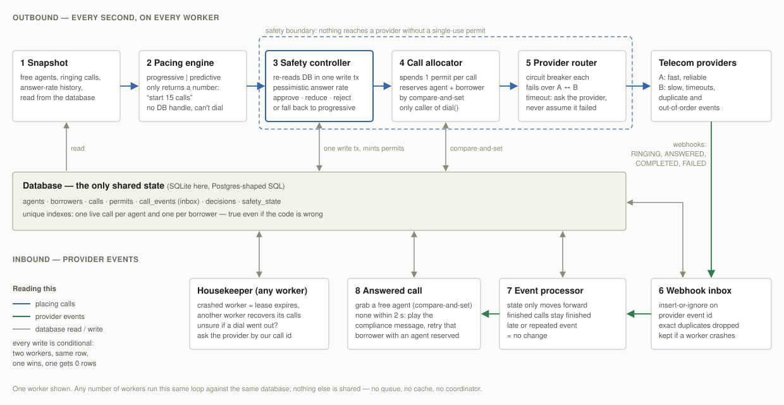

# SmartDialer

A working prototype of an outbound collections dialer with progressive and predictive pacing,
where the predictive algorithm can never place a call directly. Every call goes through an
independent Safety Controller that issues single-use permits from a ledger shared by all workers.



State machines, concurrency and failure handling in detail: [docs/ARCHITECTURE.md](docs/ARCHITECTURE.md).

Results at a glance (100 agents, 20 simulated minutes, details in [docs/RESULTS.md](docs/RESULTS.md)):

| Answer rate / talk time | Progressive busy | Predictive busy | Abandon rate |
|---|---|---|---|
| 20% / 120 s | 56.5% | 82.8% | 0% |
| 50% / 90 s | 75.7% | 83.2% | 0% |
| 70% / 180 s | 90.4% | 91.8% | 0% |
| changing | 64.5% | 80.5% | 0% |

Zero double allocations and zero invariant violations across all scenario runs, 49 tests, and
over 100k contended allocations in the load test. Across the eight failure drills (provider B,
outages, agent drop, worker crashes, three workers, 5x-too-aggressive pacer) the only abandons
come from the answer rate jumping 10% -> 70% (F6): 12 calls, 1.49%, before the breaker forced
progressive. Open `docs/dashboard.html` to see every run.

## Setup

Python 3.10+. Standard library only for the dialer; pytest for tests; matplotlib only for charts.

```bash
python -m venv .venv && source .venv/bin/activate   # Windows: .venv\Scripts\activate
pip install -r requirements.txt
```

## Run

```bash
python -m pytest -q                 # 49 tests, ~10 s
python -m sim.run                   # all 16 scenarios, 2-5 min -> docs/RESULTS.md, docs/results/*, dashboard
python -m sim.run --quick           # 10-minute scenarios, about half the time
python -m sim.run --only F3         # one scenario (prefix match); updates its row and the dashboard
python -m loadtest.load_test        # ~1-2 min -> docs/LOAD.md
python -m sim.dashboard             # rebuild docs/dashboard.html from existing results
```

`docs/dashboard.html` is a single static page, no server: agent states over time, what the
pacer asked for against what safety approved, and every safety decision with its reason. Click
a chart to jump the decision log to that second. Refresh it after a run.

Every pacing decision of a run is in `docs/results/<scenario>.decisions.jsonl` with the
pacer's rationale and the safety controller's numbers and reasons.

## Layout

```
smartdialer/
  models.py       agent + call state machines, event resolution (pure)
  db.py           schema, transactions (BEGIN IMMEDIATE), unique-index backstops
  repo.py         compare-and-set primitives: reserve agent, claim borrower, transitions
  ledger.py       snapshot / statistics read model
  pacing.py       ProgressivePacer, PredictivePacer (no access to DB, provider or safety)
  safety.py       SafetyController (gates, overflow bound, permits), PermitVerifier
  allocator.py    CallAllocator: the only caller of provider.dial()
  events.py       webhook inbox + exactly-once processing
  recovery.py     abandon timer, crash recovery, reconciliation, lease expiry
  health.py       circuit breaker + provider router
  worker.py       the worker loop
  invariants.py   cross-table invariants checked by tests and the simulator
  providers/      interface + mock providers A (fast, reliable) and B (slow, timeouts,
                  duplicates, reordering), outage switch
sim/              virtual-clock simulator driving the real code; scenario runner;
                  dashboard.py + dashboard.html (template) build docs/dashboard.html
loadtest/         contention, decision-cost and event-throughput benchmarks
tests/            state machines, races, events, crash recovery, safety, allocator, end-to-end
docs/
  ARCHITECTURE.md diagram, state machines, concurrency, failure handling
  PACING.md       predictive logic, safety bound, a decision explained end to end
  ADR.md          decisions and trade-offs
  SCALE.md        what breaks first at 1k / 10k / 100k agents, and the fix
  RESULTS.md      generated simulation report with charts
  LOAD.md         generated load test report
  dashboard.html  generated, open in a browser
  FINAL_ANSWER.md the closing question
```

## The ideas that matter

1. **The database is the only shared state.** Every mutation is a conditional UPDATE in a
   write transaction; partial unique indexes make "one agent, one live call" and "one borrower,
   one live call" true even if the application code is wrong.
2. **Safety owns the budget.** It recomputes capacity under the write lock, counts every
   worker's open permits, uses a pessimistic answer rate, and mints HMAC-signed, 3-second,
   single-use permits. A 5x-too-aggressive pacer produces identical results to a correct one.
3. **Deterministic floor, statistical middle.** Progressive capacity assumes every ringing call
   answers. Predictive room comes from a binomial overflow bound at the upper confidence bound of
   the answer rate. A rolling abandon-rate breaker forces all workers back to progressive before
   the regulatory limit.
4. **Providers are hostile.** Webhooks land in an inbox with a unique key; transitions are
   monotonic and terminal states absorb; a timed-out dial is never assumed to have failed: we ask
   the provider by our own call id before releasing anything.
5. **Crashes are leases expiring.** Any worker can recover any other worker's half-finished
   work, and a CAS guarantees only one does.

## What I'm least confident about

* **The safety bound is conservative.** It leaves ~15% of agents idle at a 20% answer rate
  (82.8% busy where a tuned predictive dialer might reach ~90%). I chose safety over the last
  few points on purpose; PACING.md explains the trade.
* **The pacer and safety disagree a lot.** The pacer asks from the expected answer rate; safety
  allows from a pessimistic upper bound and counts calls already in flight, so most predictive
  requests come back reduced or rejected. Safe, but it means the pacer gives direction and
  safety sets the number.
* **SQLite's single write lock** is the first thing to break as agents grow. The SQL is
  Postgres-shaped; SCALE.md says when and how to switch.

## With another week

1. A time-aware safety bound (answers spread over ring time, agents freeing at a measurable
   rate), run in shadow mode next to the current one and promoted only if its real abandon rate
   stays under target. Same breaker and permit ledger behind it.
2. A pacer that accounts for in-flight calls the way safety does, so it asks for numbers
   safety can actually approve.
3. Postgres instead of SQLite once past ~1k agents.
4. A real Plivo adapter on the same provider interface (mapping sketched in ARCHITECTURE.md
   section 8).
5. Compliance basics not built here: calling-hour windows, DNC lists, consent, per-borrower
   contact caps, retention of the inbox and decision tables.
