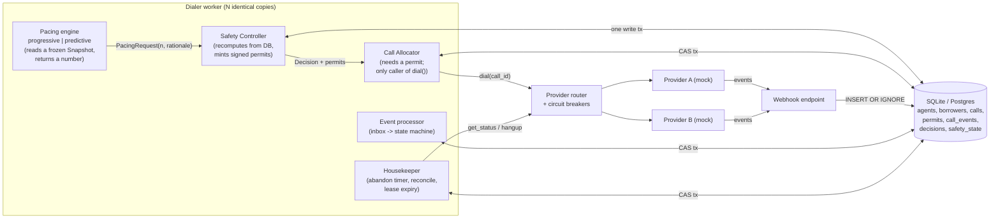
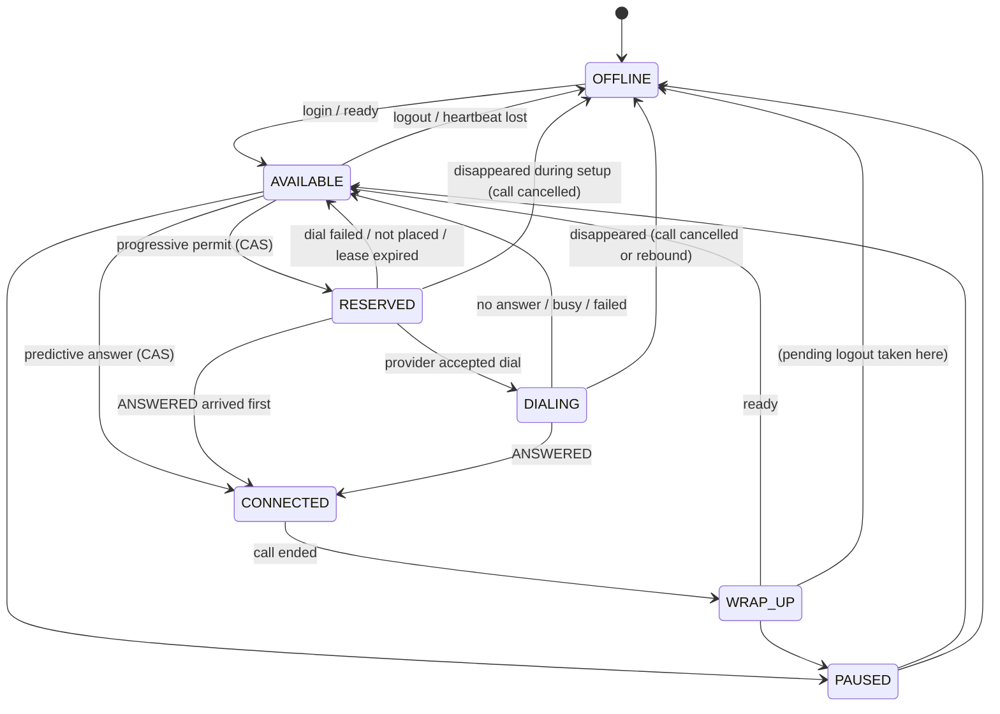

# SmartDialer

A working prototype of an outbound collections dialer with progressive and predictive pacing,
where the predictive algorithm can never place a call directly. Every call goes through an
independent Safety Controller that issues single-use permits from a ledger shared by all workers.


**Contents:** [Setup](#setup) · [Run](#run) · [Architecture](#architecture) (state machines, two workers on one agent, events, failures) · [Predictive pacing](#predictive-pacing-and-the-safety-controller) · [Scale](#scale-100--1000--10000-agents) · [Design decisions](#design-decisions) · [Limits](#what-im-least-confident-about) · [Final question](#final-question)

Results at a glance (100 agents, 20 simulated minutes, details in [docs/RESULTS.md](docs/RESULTS.md)):

| Answer rate / talk time | Progressive busy | Predictive busy | Abandon rate |
|---|---|---|---|
| 20% / 120 s | 56.5% | 82.8% | 0% |
| 50% / 90 s | 75.7% | 83.2% | 0% |
| 70% / 180 s | 90.4% | 91.8% | 0% |
| changing | 64.5% | 80.5% | 0% |

Zero double allocations and zero invariant violations across all scenario runs, 49 tests, and
over 100k contended allocations in the load test. Across the eight failure drills (provider B,
outages, agent drop, worker crashes, three workers, 5x-too-aggressive pacer) the only abandons
come from the answer rate jumping 10% -> 70% (F6): 12 calls, 1.49%, before the breaker forced
progressive. Open `docs/dashboard.html` to see every run.

## Setup

Python 3.10+. Standard library only for the dialer; pytest for tests; matplotlib only for charts.

```bash
python -m venv .venv && source .venv/bin/activate   # Windows: .venv\Scripts\activate
pip install -r requirements.txt
```

## Run

```bash
python -m pytest -q                 # 49 tests, ~10 s
python -m sim.run                   # all 16 scenarios, 2-5 min -> docs/RESULTS.md, docs/results/*, dashboard
python -m sim.run --quick           # 10-minute scenarios, about half the time
python -m sim.run --only F3         # one scenario (prefix match); updates its row and the dashboard
python -m loadtest.load_test        # ~1-2 min -> docs/LOAD.md
python -m sim.dashboard             # rebuild docs/dashboard.html from existing results
```

`docs/dashboard.html` is a single static page, no server: agent states over time, what the
pacer asked for against what safety approved, and every safety decision with its reason. Click
a chart to jump the decision log to that second. Refresh it after a run.

Every pacing decision of a run is in `docs/results/<scenario>.decisions.jsonl` with the
pacer's rationale and the safety controller's numbers and reasons.

## Layout

```
smartdialer/
  models.py       agent + call state machines, event resolution (pure)
  db.py           schema, transactions (BEGIN IMMEDIATE), unique-index backstops
  repo.py         compare-and-set primitives: reserve agent, claim borrower, transitions
  ledger.py       snapshot / statistics read model
  pacing.py       ProgressivePacer, PredictivePacer (no access to DB, provider or safety)
  safety.py       SafetyController (gates, overflow bound, permits), PermitVerifier
  allocator.py    CallAllocator: the only caller of provider.dial()
  events.py       webhook inbox + exactly-once processing
  recovery.py     abandon timer, crash recovery, reconciliation, lease expiry
  health.py       circuit breaker + provider router
  worker.py       the worker loop
  invariants.py   cross-table invariants checked by tests and the simulator
  providers/      interface + mock providers A (fast, reliable) and B (slow, timeouts,
                  duplicates, reordering), outage switch
sim/              virtual-clock simulator driving the real code; scenario runner;
                  dashboard.py + dashboard.html (template) build docs/dashboard.html
loadtest/         contention, decision-cost and event-throughput benchmarks
tests/            state machines, races, events, crash recovery, safety, allocator, end-to-end
docs/
  workflow.svg    the diagram above
  RESULTS.md      simulation report with charts (written by sim.run)
  LOAD.md         load test report (written by loadtest.load_test)
  dashboard.html  every run and every safety decision, open in a browser
```

## The ideas that matter

1. **The database is the only shared state.** Every mutation is a conditional UPDATE in a
   write transaction; partial unique indexes make "one agent, one live call" and "one borrower,
   one live call" true even if the application code is wrong.
2. **Safety owns the budget.** It recomputes capacity under the write lock, counts every
   worker's open permits, uses a pessimistic answer rate, and mints HMAC-signed, 3-second,
   single-use permits. A 5x-too-aggressive pacer produces identical results to a correct one.
3. **Deterministic floor, statistical middle.** Progressive capacity assumes every ringing call
   answers. Predictive room comes from a binomial overflow bound at the upper confidence bound of
   the answer rate. A rolling abandon-rate breaker forces all workers back to progressive before
   the regulatory limit.
4. **Providers are hostile.** Webhooks land in an inbox with a unique key; transitions are
   monotonic and terminal states absorb; a timed-out dial is never assumed to have failed: we ask
   the provider by our own call id before releasing anything.
5. **Crashes are leases expiring.** Any worker can recover any other worker's half-finished
   work, and a CAS guarantees only one does.

## Architecture

### 1. Shape



Plain text version of the main path, as the brief asked:

```
Campaign -> Pacing Engine -> Safety Controller -> Call Allocator -> Provider Router -> Telecom Provider
              (asks)          (decides, mints      (consumes one       (breaker per
                               permits)             permit per call)    provider)
                                    \___________ all state in one DB ___________/
                                                        ^
                       Provider webhooks -> inbox table -+-> Event processor
```

There is no queue, cache, or coordinator service. Every worker runs the same loop and every
shared decision goes through a conditional write in the database. See
[Design decisions](#design-decisions) for why.

#### The worker loop (`smartdialer/worker.py`)

```
every ~0.5 s   service(): process inbox events, bind waiting answered calls, run the 2 s
                          abandon timer, execute pending hang-ups
every 1 s      pace():    housekeeping -> snapshot -> pacer.request() -> safety.evaluate()
                          -> cancel excess (if told) -> allocator.execute(permits)
```

#### Why the pacing engine cannot bypass safety

1. The pacer is constructed with no database handle, no router, no allocator and no
   `SafetyConfig`. Its only input is a frozen `Snapshot`; its only output is a
   `PacingRequest`. (`tests/test_safety.py::test_pacer_cannot_reach_provider_or_safety`)
2. `provider.dial()` is called in exactly one place: `CallAllocator._dial`, reached only via
   `place(permit)`.
3. `place()` requires a permit that (a) carries a valid HMAC from the safety controller's key,
   (b) is unexpired (3 s TTL), (c) is atomically marked consumed in the same transaction that
   reserves the agent and borrower. Reused, forged, mode-tampered or expired permits are refused.
4. `SafetyConfig` is a frozen dataclass set by operators at start-up.
5. Safety does not trust the pacer's numbers. It re-reads counts inside its own write
   transaction and uses its own (pessimistic) answer-rate estimate.

In production I would go one step further and run the safety controller + allocator as the
only process that holds provider credentials, so a buggy pacer deployment physically cannot
dial. In this prototype the boundary is enforced in code and tested.

### 2. Agent state machine



`agents.call_id` points at the call the agent is bound to. A CONNECTED agent who logs out gets
`pending_offline=1` and leaves at wrap-up; we never yank an agent out of a live conversation.

#### Two workers see the same AVAILABLE agent

Reservation is a single statement inside `BEGIN IMMEDIATE`:

```sql
UPDATE agents SET state='RESERVED', call_id=?, lease_owner=?, lease_until=?, version=version+1
WHERE id = (SELECT id FROM agents WHERE state='AVAILABLE' ORDER BY state_since, id LIMIT 1)
  AND state='AVAILABLE'
RETURNING id
```

* `BEGIN IMMEDIATE` takes SQLite's write lock before reading, so the read and the write of
  one worker cannot interleave with another's. Worker 2 waits (busy_timeout), then re-runs
  the subquery and gets the next agent or nothing.
* `AND state='AVAILABLE'` is the compare-and-set. Even under a weaker isolation level (Postgres
  READ COMMITTED), the second UPDATE re-checks the row after the first commits, matches zero
  rows, and returns nothing. On Postgres I would add `FOR UPDATE SKIP LOCKED` in the subquery
  so workers take different agents instead of queueing on the same row.
* Backstop independent of all application code: two partial unique indexes,
  `calls(agent_id)` and `calls(borrower_id)` over non-terminal states. A bug that tried to bind
  one agent (or one borrower) to two live calls fails with an IntegrityError.

Tests: `test_two_threads_same_agent` (30 rounds of a two-thread barrier race on one agent),
`test_many_processes_never_double_allocate` (6 OS processes, 50 agents, 60 borrowers: every
agent and borrower allocated exactly once), `test_database_backstop_rejects_second_active_call_per_agent`,
`test_stale_cas_loses`. The load test re-checks invariants after over 100k contended allocations.

**"DB says AVAILABLE, cache says RESERVED, which wins?"** The database. There is no cache in
this design; if one were added for dashboards or for pre-filtering candidates, it would be a
hint only. No decision that matters (reserve, bind, permit) is made from a cache; every one is a
CAS against the row of record, so a stale cache can at worst make a worker try and lose.

### 3. Call state machine


Pre-dial states may jump straight to any later state when a provider event arrives, because
an event is proof the dial happened (this is what makes "worker crashed after dial" heal by
itself).

#### Rules that make hostile event streams safe (`models.resolve_event`)

1. **Rank is monotonic.** QUEUED 0 < RESERVED 1 < INITIATED 2 < RINGING 3 < ANSWERED 4 <
   CONNECTED 5 < terminal 9. An event that implies a lower rank than the current state is
   `stale` and ignored.
2. **Terminal absorbs.** After COMPLETED/FAILED/CANCELLED/ABANDONED, every event is
   `after_terminal` and changes nothing.
3. **Same state = duplicate.** Three ANSWERED events yield one transition.
4. **Facts are kept even when transitions are not.** `ANSWERED` after `COMPLETED` still sets
   `net_outcome='ANSWER'` so the answer-rate statistics are right.
5. `COMPLETED` is interpreted with context: `answered=true` (or a call already ANSWERED or
   CONNECTED) means COMPLETED, otherwise FAILED/no-answer.

| Provider sends | Result |
|---|---|
| ANSWERED, ANSWERED, ANSWERED, COMPLETED | applied, duplicate, duplicate, applied -> COMPLETED, one bridge |
| COMPLETED, ANSWERED, RINGING | applied, after_terminal, after_terminal -> COMPLETED, answer recorded |
| any permutation of RINGING/ANSWERED/COMPLETED plus a duplicate | always ends COMPLETED (exhaustively tested) |

#### Inbox and exactly-once effect

* Webhook handler = `INSERT OR IGNORE INTO call_events ... UNIQUE(provider, event_id)`.
  An exact redelivery is dropped here. Return 200 only after this commits.
* Processing = one transaction: `UPDATE call_events SET processed=1 WHERE seq=? AND processed=0`
  (claim), then apply the transition and every side effect (agent bind/release, borrower
  outcome). If the worker dies mid-way, the whole thing rolls back and the event is still
  unprocessed for any other worker. If two workers race on the same event, one gets rowcount 0.
* The only side effect outside the DB is `provider.bridge()`, done after commit and idempotent.
  If it fails, `calls.bridged_at` stays NULL and the housekeeper retries it.

### 4. Progressive flow

```
safety: prog_cap = free_agents - unbacked_in_flight - open_permits        (deterministic)
allocator, one tx:  consume permit (CAS) -> reserve agent (CAS) -> claim borrower (CAS)
                    -> insert call RESERVED with lease (owner = worker, 10 s)
dial(call_id)       call_id doubles as idempotency key
  ok        tx: call -> INITIATED, agent RESERVED -> DIALING (CAS on agent.call_id)
            if the agent CAS fails, the agent disappeared during setup -> flag cancel -> hang up,
            borrower requeued without penalty
  timeout   outcome unknown: keep agent + borrower, mark dial_uncertain, lease = now + 3 s;
            housekeeper asks get_status(call_id): known -> adopt, unknown -> FAILED + backoff
  error     tx: call FAILED, agent AVAILABLE, borrower provider backoff (not an attempt)
ANSWERED    tx: agent DIALING -> CONNECTED, call -> CONNECTED; bridge after commit
```

Which borrower: highest `priority`, earliest `next_attempt_at`, with previously abandoned
borrowers (`progressive_only=1`) first. Which agent: longest idle (`state_since`).
When the agent becomes reserved: in the same transaction that consumes the permit and claims
the borrower, before any network call. If the reserved agent disappears after the provider
already got an ANSWERED, the call is treated like a predictive answer: bind any free agent
within the 2 s grace, otherwise abandon (tested in `test_agent_disappears_while_dialing_but_borrower_answers_first`).

### 5. Predictive flow

Same, except the permit is PREDICTIVE: no agent is reserved, the call is QUEUED/INITIATED with
`agent_id NULL` ("unbacked"). On ANSWERED, the event transaction binds the longest-idle
AVAILABLE agent directly to CONNECTED. If none is free, the call waits in ANSWERED; every
service tick tries again in answer order; after 2 s it is ABANDONED, a compliance message is
played via hang-up, and the borrower is flagged `progressive_only` so the next attempt is
guaranteed an agent. The pacing logic and the safety bound are in [Predictive pacing](#predictive-pacing-and-the-safety-controller).

### 6. Failure handling

| Case | What happens | Where |
|---|---|---|
| Worker crash after reserve, before dial | Call stays RESERVED with a 10 s lease. After expiry any worker's housekeeper sees `provider IS NULL` -> FAILED `not_dialed`, agent AVAILABLE, borrower requeued, no attempt counted | `recovery.reconcile_predial`, `test_worker_crash_before_dial_releases_everything` |
| Worker crash after dial, before recording | Events for that call land in the inbox and move it forward anyway (pre-dial states accept them). If no event yet, after the lease the housekeeper asks `get_status(call_id)`: provider knows it -> adopt (INITIATED, agent DIALING) | `test_worker_crash_after_dial_is_adopted`, sim F4 |
| Worker crash mid-event | Transaction rolls back, event stays unprocessed, another worker applies it. ANSWERED-crash-COMPLETED ends COMPLETED with agent in WRAP_UP | `test_crash_inside_answered_processing_then_completed` |
| Crash after ANSWERED committed, before bridge | CONNECTED with `bridged_at NULL`, retried by housekeeper | `test_crash_after_answered_commit_before_bridge` |
| Provider timeouts on dial | Breaker opens after 3 consecutive timeouts or 50% failures over 20; safety then REJECTS all new dials (no provider admits calls); half-open after 10 s lets 2 probes through; router fails over to the next healthy provider if configured | `health.py`, sim F2/F2b |
| Existing calls during outage | Left alone; their webhooks queue at the provider and arrive late. Calls with no event for 90 s are reconciled with `get_status`; if the provider is unreachable for 3x that, best-effort hang-up and FAILED `provider_lost` so agents are not held hostage | `reconcile_stale` |
| Retries during outage | Borrowers whose dial failed because of the provider are retried with exponential backoff and jitter (5 s, 10 s, 20 s ... cap 300 s); this does **not** count as a borrower attempt | `repo.settle_borrower` |
| Pacing during outage | Provider failures are not network outcomes, so they never enter the answer-rate window. Without this, an outage would look like "nobody answers" and the pacer would dial harder exactly when it should stop | `ledger.read_snapshot` |
| 40 of 100 agents vanish | Next safety decision (<= 1 s) sees `recently_left`, recomputes the bound against the new free count, revokes unused permits, cancels the excess unbacked calls (not-yet-ringing first), and approves 0 until in-flight drains | sim F3 trace in RESULTS.md, `test_agent_drop_cancels_excess_ringing` |
| Duplicate events | Exact: dropped at the inbox by unique key. Semantic (new id): `duplicate`/`stale` no-op | sim F1: hundreds dropped, 0 extra transitions |
| Out-of-order events | Monotonic rank + terminal absorption | `test_every_ordering_of_a_normal_call_converges` |
| Stale agent presence | Agents whose heartbeat is older than 15 s are not counted as free by safety and are logged out by the housekeeper | `ledger.stale_heartbeats`, `recovery.agent_presence` |

### 7. Multiple workers on one campaign

| Concern | Mechanism |
|---|---|
| Agent allocation | CAS reserve inside a write transaction + unique index backstop |
| Borrower allocation | CAS claim with lease + unique index (one active call per borrower) + `settle_borrower` guarded on `last_call_id`, so a late outcome for an old call cannot touch a newer attempt |
| Pacing overshoot (N workers each say "15 more") | Safety counts unconsumed, unexpired permits from *all* workers as in-flight, inside its write transaction. Three workers asking for 3 calls with 3 free agents get 3 total, not 9 (`test_concurrent_workers_share_one_budget`, sim F5) |
| Duplicate jobs / retries | Permits are single-use; `calls.permit_id` is UNIQUE; dial is idempotent on our call_id |
| Concurrent updates | Every mutation is `UPDATE ... WHERE state IN (expected)` and checks rowcount |
| Worker crashes | Leases on calls, agents and borrowers; any worker's housekeeper recovers expired ones after asking the provider |
| Stale state | Pacer may be stale; safety is not (fresh read under the write lock); permits expire in 3 s; requests older than 2 s are rejected |
| Provider events | Land in a shared inbox; any worker processes them; one transaction per event |

Circuit breakers are per worker process (in memory). Each worker learns about an outage from
its own failures within a few calls. Sharing breaker state through the DB would make workers
agree faster but would add a write on every dial; per-worker was the simpler trade here.

### 8. Real provider (not built)

The mock interface is the shape a Plivo adapter would take: `dial()` maps to the Call API
with our `call_id` in the answer URL / custom headers; the webhook handler maps Plivo's
`CallStatus` (`ringing`, `in-progress`, `completed`, `busy`, `no-answer`, `failed`) onto
RINGING / ANSWERED / COMPLETED / FAILED and uses Plivo's request UUID + status as `event_id`;
`get_status()` maps to the call-detail lookup; `bridge()` is a conference/transfer to the
agent leg. I did not build it because without real handsets the interesting failure modes
(duplicates, reordering, outages) are easier to exercise with the mocks.

## Predictive pacing and the Safety Controller

### The split

| | Pacing engine | Safety Controller |
|---|---|---|
| Job | "How many calls would keep agents busy?" | "How many calls are we allowed to have in flight?" |
| Inputs | Frozen `Snapshot` (may be up to 2 s old) | Fresh read inside its own write transaction |
| Answer rate | Point estimate (Beta prior + window) | Upper confidence bound (pessimistic) |
| Credits agents about to free up | Yes (expected value) | No. Only agents AVAILABLE now with a fresh heartbeat |
| Can be wrong in the aggressive direction | Yes, by design | No: this is the one that must not be |
| Output | A number + rationale | Signed single-use permits + verdict + reasons |

The pacer is allowed to be clever and wrong. The safety controller is deliberately simple,
pessimistic, and the only path to the provider.

### Predictive pacer (`smartdialer/pacing.py`)

```
p          = (prior_p*w + answers_long + answers_short) / (w + n_long + n_short)    (short window weighted 2x)
             raised to the answers already seen among calls dialed in the last 30 s
horizon    = avg ring-to-answer + 1 s
soon_free  = CONNECTED * min(1, horizon / avg_talk) + WRAP_UP * min(1, horizon / wrap)
capacity   = AVAILABLE + soon_free - answered_waiting
in_flight  = unbacked calls ringing + unconsumed predictive permits
request    = floor( aggressiveness * (capacity - in_flight * p) / p )
```

Uses current availability, connected and ringing calls, historical answer rate, setup/ring
time, average talk time and wrap time. Provider health is deliberately left to the safety
controller and the router, and provider failures never enter the answer-rate statistics (an
outage would otherwise look like "nobody answers" and make the pacer dial harder).

### Safety Controller (`smartdialer/safety.py`)

Evaluated in order, inside one `BEGIN IMMEDIATE` transaction:

| # | Gate | Kind | Effect |
|---|---|---|---|
| 1 | Rolling abandon rate (15 min) >= 2.5% (legal cap 3%) | deterministic | **Trip:** force PROGRESSIVE for all workers (state in DB) until rate <= 1.0% and >= 60 s cooldown |
| 2 | Request based on a snapshot older than 2 s | deterministic | REJECT |
| 3 | No provider breaker admits calls | deterministic | REJECT; half-open: cap at probe count |
| 4 | Fewer than 40 resolved outcomes (cold start) | deterministic | FALLBACK to progressive |
| 5 | Agents gone (stale heartbeat) | deterministic | Not counted as free |
| 6 | Capacity shock (>= 5% of agents left in 30 s, or answer-rate shift) with unbacked calls above the bound | statistical | Revoke unused permits, then **cancel** excess calls, not-yet-ringing first |
| 7 | Unbacked in flight <= 4 x free agents; <= provider concurrency | deterministic ceiling | REDUCE |
| 8 | Overflow bound (below) | statistical, pessimistic | REDUCE / REJECT |

In PROGRESSIVE (requested, cold start, or forced) the approval is
`free_agents - unbacked_in_flight - open_permits`: every in-flight call that has no agent is
treated as a certain answer, so the worst case is zero abandons. Borrowers who were abandoned
before are always served with agent-bound calls first, even in predictive mode.

#### The overflow bound

Let `C` = agents AVAILABLE right now that nobody has claimed, `m` = unbacked calls in flight
after this decision, `X ~ Binomial(m, p_hi)` = how many of them answer.

```
E[abandon]  = E[(X - C)+]          (answers with no agent)
E[connect]  = E[min(X, C)]
approve the largest m with   E[abandon] <= eps * E[connect]
```

* `p_hi` = Wilson upper bound (one-sided 95%) on the last 400 resolved outcomes. A short window
  of 40 overrides it only when its *lower* bound is above the long upper bound (a real shift,
  not noise). The answers already seen among calls dialed in the last 30 s act as a floor.
* `eps` = 1.5%, shrinking to 0 as the rolling abandon rate approaches the 2.5% trip.
* The model assumes every ringing call could answer at the same instant against today's free
  agents, and that no agent frees up meanwhile. Both are false in the safe direction. That is
  why measured abandon rates sit at 0% in normal conditions.

#### Why 5 calls and not 44? (real decision from scenario B, t = 401 s)

The pacer: p = 0.52, 20 free, 16.1 expected to free within the 9.3 s horizon, so capacity
36.1; 25 calls already ringing will bring ~13 answers; deficit 23.1; 23.1 / 0.52 = **44**.

The safety controller: 20 free agents (it does not credit the 16 that may free up),
p_hi = 0.568, 25 calls already ringing.

| total in flight m | E[abandon] | E[connect] | ratio |
|---|---|---|---|
| 25 (now) | 0.005 | 14.2 | 0.04% |
| **30** | **0.178** | **16.9** | **1.05%** |
| 31 | 0.282 | 17.3 | 1.63% (> 1.5%) |
| 69 (what the pacer wanted) | 19.2 | 20.0 | 96% |

So `m = 30`, room = 30 - 25 = **5** permits. Verdict REDUCED, reason
`overflow bound: p_hi=0.568, eps=1.500% allows 30 in flight for 20 agents`. Every decision is
stored in the `decisions` table (and `docs/results/*.decisions.jsonl`) with both sides'
numbers, so any "why 17 and not 10" question is a lookup.

### What the simulator showed

Full tables and charts: [RESULTS.md](docs/RESULTS.md). 100 agents, 20 simulated minutes, provider A.

| Scenario | Progressive busy | Predictive busy | Connects/agent-hour | Abandon |
|---|---|---|---|---|
| A: 20% answer, 120 s talk | 56.5% | 82.8% | 16.0 -> 23.4 (+47%) | 0% |
| B: 50%, 90 s | 75.7% | 83.2% | 27.7 -> 30.8 (+11%) | 0% |
| C: 70%, 180 s | 90.4% | 91.8% | 19.1 -> 19.7 (+3%) | 0% |
| D: 20% -> 70% -> 10%, talk 120 -> 180 -> 90 s | 64.5% | 80.5% | 16.0 -> 20.8 (+30%) | 0% |

The gain is largest where progressive hurts most (low answer rate), and nearly zero where
agents are already saturated by long calls.

Stress runs:

* **Pacing bug (aggressiveness 5x):** identical results to B (same calls, connects, utilisation). The safety
  boundary, not the pacer, sets the rate.
* **Answer rate jumps 10% -> 70% (F6):** the dangerous direction. Calls dialed under the old
  estimate answered in a burst: 12 abandons in ~3 s. The rolling breaker tripped at t=333
  (5.0% over a 238-call window) and forced progressive for every worker; zero abandons after.
  Over the run: 1.49%, under the 3% cap. This is the layered design working: the statistical
  layer was wrong because the world changed, the deterministic layer bounded the damage.
* **Answer rate drops 70% -> 10% (D, third phase):** the safe direction. Fewer answers than
  expected means idle agents, not abandons; the estimate catches up within the 400-outcome
  window and the pacer dials harder again.
* **40% of agents vanish (F3):** the decision in the same second sees the drop, cancels 16
  unbacked calls and approves nothing until ringing calls drain to the new bound. Agents who
  were mid-call leave after their call ends, so free capacity drops by the agents that were
  actually idle (17 -> 10), not by 40 at once.

### Known weaknesses

* The bound is static in time. It leaves ~15% of agents idle at a 20% answer rate. A
  time-aware bound (answers arrive spread over the ring-time distribution; agents free at a
  measurable rate) would recover most of that. I did not ship it because it puts a prediction
  of human behaviour (talk-time) inside the safety layer. I would add it behind the same
  breaker, measured against the static bound in shadow mode first.
* Slow webhooks eat the 2 s grace: with provider B, 78 calls were connected more than 2 s after
  the borrower answered (by provider timestamp) because the ANSWERED event itself arrived late.
  We connect them anyway if an agent is free; the metric is reported, and provider choice for
  predictive campaigns should take webhook latency into account.
* Cancelling ringing calls on a capacity shock is ring-and-drop. Some regimes (for example a
  minimum 15 s ring rule) restrict it. The controller only does it on shocks, prefers calls
  not yet ringing, and the threshold is separate (6% expected abandon) from the one for new
  calls (1.5%).

## Scale: 100 → 1,000 → 10,000 agents

Measured numbers are from [LOAD.md](docs/LOAD.md) (2-core container, SQLite WAL).

### What the load is

Per agent, at a 20% answer rate and ~130 s per conversation cycle: ~0.008 connects/s, ~0.04
dials/s, ~0.15 provider events/s, ~0.25 write transactions/s.

| Agents | Dials/s | Events/s | Write tx/s | Safety decisions/s (1 per worker per s) |
|---|---|---|---|---|
| 100 | 4 | 15 | 25 | N workers |
| 1,000 | 40 | 150 | 250 | N workers |
| 10,000 | 400 | 1,500 | 2,500 | N workers |
| 100,000 | 4,000 | 15,000 | 25,000 | N workers |

The prototype sustains 3,000-5,000 contended allocations/s (two transactions each) and ~4,000
events/s on one SQLite file, so raw allocation throughput is not what breaks first.

### What breaks first: the safety decision holds the global write lock while it scans

One decision = a full snapshot (agent counts by state, active calls grouped by state, the last
400 resolved outcomes, abandons and connects in a 15-minute window) + the bound + permit inserts,
all inside one write transaction so that N workers cannot overshoot.

| Agents | Decision p50 | of which snapshot |
|---|---|---|
| 100 | 4.6 ms | 4.4 ms |
| 1,000 | 19.4 ms | 16.7 ms |
| 10,000 | 55.6 ms | 36.3 ms |

The snapshot is O(rows) and grows with agents and with the abandon window. With 10 workers each
deciding once per second at 10k agents, the write lock is held for decisions ~55% of every
second, and every allocation and event transaction queues behind it. It is the serialization
point by design (that is what makes the budget global), so it must be made cheap, not removed.

**Fix, in order:**

1. **O(1) snapshot.** Keep a `pool_counters` row (agents by state, unbacked/backed in flight,
   open permits) updated inside the same transactions that change state, and per-minute
   bucket rows for outcomes/connects/abandons. The decision reads a handful of rows instead of
   scanning tables. Same correctness (counters change in the same transaction as the state
   they count); decision cost becomes independent of agent count.
2. **One decider per pool, not per worker.** A lease-held pacing leader per pool makes the
   decision once per second and publishes permits; other workers only consume permits and
   process events. Decisions/s becomes "number of pools", not "number of workers".
3. **Shard the ledger by agent pool.** An agent only takes calls for its pool (team / skill /
   campaign), so pools are independent safety domains with their own counters row, permits and
   breaker state. 10k agents = e.g. 50 pools of 200: 50 hot rows instead of one. Trade-off:
   predictive efficiency comes from pooling, and very small pools (< ~50 agents) get noticeably
   less overdial room from the same bound. Pools of a few hundred keep almost all of it.

### What breaks second

* **SQLite's single writer.** Move to Postgres: row locks instead of a database lock,
  `FOR UPDATE SKIP LOCKED` for agent and borrower claims so workers take different rows instead
  of queueing on the same one, partial unique indexes carry over unchanged. Then shard databases
  by pool group when one primary's write rate is the limit (around the 100k-agent row above).
* **Event inbox in the same database as allocation.** At 1,500 events/s it competes with
  allocation for the write path. Move ingestion to an append-only log partitioned by call_id
  (Postgres partitioned table first, Kafka only if that is not enough), consumers per partition.
  Per-call partitioning gives per-call ordering for free, though the state machine stays
  order-independent because providers reorder before we see anything.
* **Agent presence writes.** 10k agents heartbeating every 5 s is 2,000 writes/s of pure noise.
  Batch them, or hold presence in an in-memory TTL store that feeds logout transitions into the
  DB via CAS. That store is an input, never a source of truth for reservations: this is where
  "the cache says RESERVED, the DB says AVAILABLE" would come from, and the DB wins.
* **Borrower selection.** The load test found claim was sorting every pending borrower (index
  did not match the ORDER BY): 2.4x slower at 1k agents. Fixed with a matching index. At tens of
  millions of borrowers with changing priorities, precompute a per-pool dial queue.

### What does not go away with more servers

* **Provider CPS and concurrency limits.** 10k agents at a 20% answer rate need ~400 dials/s;
  trunks and accounts are rate limited. That needs multi-trunk / multi-provider routing with the
  concurrency ceiling enforced per trunk in the safety controller (`max_concurrent_calls` is the
  hook).
* **Webhook latency.** It eats the 2 s abandon grace regardless of our capacity (provider B:
  78 late connects in 20 minutes).
* **Statistics at small scale.** The predictive bound depends on pool size; splitting a campaign
  into many tiny pools to scale the database makes the dialer less efficient.

### 1,000 -> 100,000 agents: order of failure

1. Decision snapshot under the global lock (fix: counters + one leader per pool).
2. Single-writer database (fix: Postgres, then shard by pool group).
3. Event ingestion sharing the write path (fix: partitioned log).
4. Provider CPS / trunk concurrency (fix: routing and per-trunk ceilings; a commercial problem
   as much as a technical one).
5. Presence and housekeeping scans (fix: batching, TTL store as input, indexed sweeps).

## Design decisions

Short form: what I chose, why, what it solves, what it makes harder.

### 1. One relational database is the only shared state

**Chose:** SQLite (WAL) for the prototype; the SQL is written to port directly to Postgres.
No Redis, no Kafka, no coordinator service.

**Why:** The hard part of this problem is a handful of invariants that span several entities at
once: "agent reserved AND borrower claimed AND call row created AND permit consumed", or "call
ANSWERED AND agent bound". Those want a transaction, not a choreography of messages. One store
with row-level compare-and-set gives that for free, and makes crash recovery a query instead of
a replay.

**Solves:** double allocation (CAS + unique indexes), crash consistency (all-or-nothing
transactions), cross-worker pacing (one ledger), auditability (every decision row is kept).

**Makes harder:** the database is the throughput ceiling and a single point of failure. SQLite
specifically has one writer at a time and only works on one machine; it is the prototype
choice because it needs no setup and still gives real cross-process locking. In production
this is Postgres with `SELECT ... FOR UPDATE SKIP LOCKED`, sharded by campaign/team (see
[Scale](#scale-100--1000--10000-agents)).

**Rejected:** Redis for agent state (fast, but then "reserve agent" and "insert call" are in
two systems and need a saga; and the "DB says X, cache says Y" question appears). Kafka for
provider events (ordering per call helps, but we already have to be correct under reordering
because providers reorder before Kafka sees anything; an inbox table is enough at this scale).

### 2. Compare-and-set plus leases, not distributed locks

**Chose:** every mutation is `UPDATE ... WHERE id=? AND state IN (expected)` and checks rowcount.
Ownership of in-progress work (a call being dialed, a claimed borrower, a reserved agent) is a
lease with an expiry, not a lock held by a live process.

**Why:** a crashed worker cannot release a lock, but its lease expires. Any worker can then
recover the row, and the CAS guarantees only one of them does.

**Makes harder:** every recovery path must first find out what actually happened (ask the
provider), because "lease expired" does not mean "nothing happened". That is
`reconcile_predial`. Lease lengths are tuning parameters (10 s dial lease, 3 s reconcile).

### 3. Safety Controller issues single-use signed permits from a shared ledger

**Chose:** the pacer returns a number; the safety controller recomputes capacity inside a
write transaction, counting other workers' unconsumed permits, and inserts N permit rows (HMAC
signed, 3 s TTL). The allocator consumes one per call with a CAS.

**Why:** it makes the safety boundary structural rather than a convention. The pacer has no
path to the provider, and N workers cannot each be told "15 more" against the same agents.

**Solves:** bypass, multi-worker overshoot, replay of an old decision, auditability ("why did
we dial 17?" is a row in `decisions` with both the pacer's rationale and safety's numbers).

**Makes harder:** a write transaction per decision per worker (cheap: ~4 ms at 100 agents,
~40 ms at 10k, measured). Permits that are not used still occupy budget until they expire, so
TTL must be short.

### 4. Two-layer safety: deterministic ceilings, then a pessimistic statistical bound

**Chose:** hard rules that do not depend on any model (freshness, provider breaker, dial-ratio
ceiling, concurrency ceiling, rolling abandon-rate breaker that forces progressive, cold-start
progressive), then a binomial overflow bound using the upper confidence bound of the answer rate.
Details in [Predictive pacing](#predictive-pacing-and-the-safety-controller).

**Why:** the statistical layer gives utilisation; the deterministic layer bounds the damage if
the statistical layer is wrong.

**Makes harder:** the bound is conservative by construction (assumes all ringing calls could
answer at the same instant against today's free agents), so it leaves utilisation on the table.
Measured cost in [RESULTS.md](docs/RESULTS.md).

### 5. Provider events go through an inbox table and a monotonic state machine

**Chose:** webhooks are `INSERT OR IGNORE` keyed on `(provider, event_id)`; processing is one
transaction that claims the event and applies it. Transitions only move up a rank; terminal
states absorb.

**Why:** exact duplicates are free to drop; semantic duplicates and reordering are handled by the
state machine rather than by trying to restore order (we cannot: providers do not give a
reliable sequence number across retries).

**Makes harder:** the inbox grows forever unless pruned (a retention job, not built). Processing is
serial per worker; at high event rates it needs partitioning by call_id.

### 6. Answer rate measured on resolved dial cohorts, not on recent outcomes

**Chose:** statistics use calls dialed more than 30 s ago (all outcomes known), ordered by dial
time. A separate "answers already seen among calls dialed in the last 30 s" is used as a hard
lower bound so a jump in answer rate is noticed before the cohort resolves.

**Why:** I first used "last N outcomes". It was badly biased: answers resolve in ~8 s,
no-answers in ~25 s, so the newest outcomes are mostly answers. At a true 30% the estimate read
55-60% and the safety controller cancelled ringing calls it did not need to. Found in the
simulator, fixed, documented here because it is the kind of bug that looks like "the model is
conservative".

**Makes harder:** a 30 s lag before a regime change is fully visible (hence the lower bound).

### 7. Python, virtual clock, same code in simulation and tests

**Chose:** Python standard library only (pytest and matplotlib for tests and charts). Every
component takes `now` as a parameter; nothing reads the wall clock. The simulator drives the
real worker, safety, allocator, event and recovery code with mock providers on a virtual clock.

**Why:** 20 simulated minutes run in ~15 s, runs are reproducible from a seed, and the thing
being simulated is the thing being shipped (no separate "model" of the dialer).

**Makes harder:** the simulator is single threaded, so real thread interleavings are only
covered by the concurrency tests and the load test, not by the scenario runs. Provider latency
is modelled as event delay, not as a blocking API call that ties up a worker.

### 8. Per-worker circuit breakers

**Chose:** in-memory breaker per provider per worker.

**Makes harder:** workers disagree for a few calls after an outage starts. A shared breaker in
the DB would converge faster at the cost of a write per dial outcome. Acceptable because safety
also rejects when the breaker of the deciding worker is open, and dials to a dead provider fail
fast.

## What I'm least confident about

* **The safety bound is conservative.** It leaves ~15% of agents idle at a 20% answer rate
  (82.8% busy where a tuned predictive dialer might reach ~90%). I chose safety over the last
  few points on purpose; [Predictive pacing](#predictive-pacing-and-the-safety-controller) explains the trade.
* **The pacer and safety disagree a lot.** The pacer asks from the expected answer rate; safety
  allows from a pessimistic upper bound and counts calls already in flight, so most predictive
  requests come back reduced or rejected. Safe, but it means the pacer gives direction and
  safety sets the number.
* **SQLite's single write lock** is the first thing to break as agents grow. The SQL is
  Postgres-shaped; [Scale](#scale-100--1000--10000-agents) says when and how to switch.

## With another week

1. A time-aware safety bound (answers spread over ring time, agents freeing at a measurable
   rate), run in shadow mode next to the current one and promoted only if its real abandon rate
   stays under target. Same breaker and permit ledger behind it.
2. A pacer that accounts for in-flight calls the way safety does, so it asks for numbers
   safety can actually approve.
3. Postgres instead of SQLite once past ~1k agents.
4. A real Plivo adapter on the same provider interface (mapping sketched under
   [Real provider](#8-real-provider-not-built)).
5. Compliance basics not built here: calling-hour windows, DNC lists, consent, per-borrower
   contact caps, retention of the inbox and decision tables.

## Final question

> How would you build a SmartDialer that gets as much of the utilization benefit of predictive
> dialing as possible, while retaining the deterministic safety characteristics of progressive
> dialing?

Treat predictive as a bounded overdraft on top of progressive, not as a different mode.

**1. Progressive is the floor, and it is deterministic.** Every call that has an agent reserved
is safe by construction. Count only agents free right now, and treat every unbacked call
already ringing as a certain answer. Under that rule the worst case is zero abandons. The
system starts there (cold start), returns there whenever anything looks wrong, and previously
abandoned borrowers are always served from it.

**2. Overdial is a budget owned by one component, not a number the algorithm emits.** The
pacing engine can be as clever as it likes; it only produces a request. A separate safety
controller decides how many *unbacked* calls may exist, from its own fresh read and its own
pessimistic answer rate (an upper confidence bound, not the mean), credits no agent that is
not free yet, and issues single-use, short-lived permits from one ledger shared by every worker.
The only code that can dial needs a permit. Nothing the pacer does can widen the budget.

**3. Bound the worst case with rules that do not depend on the model.** A hard dial-ratio
ceiling, provider-health gating, freshness checks, and a rolling abandon-rate breaker that puts
every worker back on pure progressive before the regulatory limit is reached. The statistical
layer can only spend what the deterministic layer allows; if the model is wrong (the answer rate
jumps from 10% to 70%), the damage is limited to calls already in flight, and the breaker stops
it. In the simulator that case cost 12 abandons in 3 seconds and then nothing.

**4. Make the answer path deterministic too.** An answered call atomically claims a free agent
or waits a fixed 2 s grace, then gets a compliant message and the borrower is flagged for an
agent-bound retry. Agent loss during setup cancels or rebinds the call. Capacity shocks revoke
permits and cancel calls that have not been answered yet.

**5. Spend the utilization where it exists.** The benefit of predictive is concentrated at low
answer rates. Here: at a 20% answer rate, 56% -> 83% agent busy time (+47% connects per agent
hour) with zero abandons; at 70% answer and long calls, +3%, because progressive is already near
full. A dialer that knows this can be aggressive only where it pays.

What I would do next to recover the remaining utilization (~15% idle at low answer rates): a
time-aware version of the bound (answers arrive spread over the ring-time distribution, agents
free at a measurable rate), run in shadow mode next to the static bound, promoted only if its
realised abandon rate stays under target. It would still sit behind the same breaker and
permit ledger, so being wrong about it costs a bounded number of calls, never an unbounded one.
