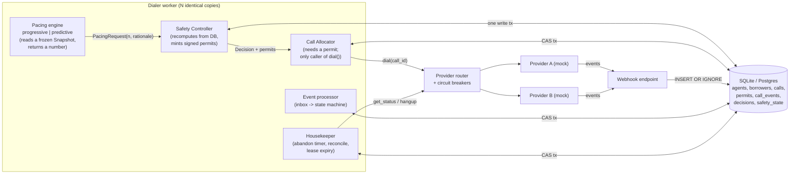
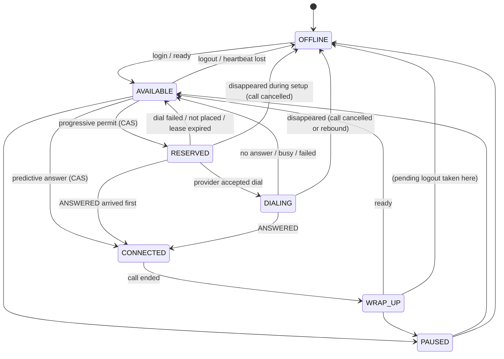
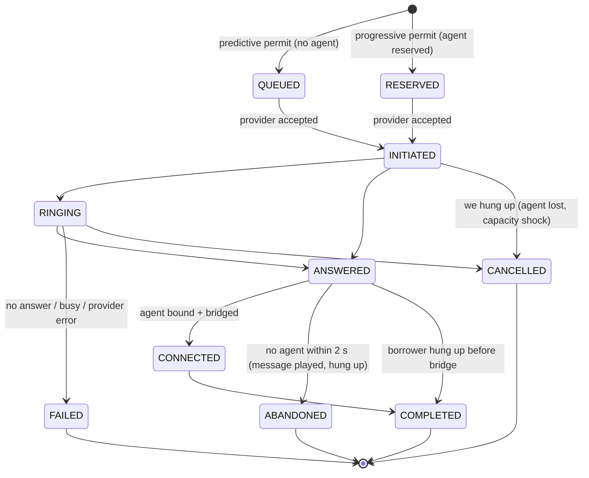

# Architecture

## 1. Shape



Plain text version of the main path, as the brief asked:

```
Campaign -> Pacing Engine -> Safety Controller -> Call Allocator -> Provider Router -> Telecom Provider
              (asks)          (decides, mints      (consumes one       (breaker per
                               permits)             permit per call)    provider)
                                    \___________ all state in one DB ___________/
                                                        ^
                       Provider webhooks -> inbox table -+-> Event processor
```

There is no queue, cache, or coordinator service. Every worker runs the same loop and every
shared decision goes through a conditional write in the database. See
[ADR.md](ADR.md) for why.

### The worker loop (`smartdialer/worker.py`)

```
every ~0.5 s   service(): process inbox events, bind waiting answered calls, run the 2 s
                          abandon timer, execute pending hang-ups
every 1 s      pace():    housekeeping -> snapshot -> pacer.request() -> safety.evaluate()
                          -> cancel excess (if told) -> allocator.execute(permits)
```

### Why the pacing engine cannot bypass safety

1. The pacer is constructed with no database handle, no router, no allocator and no
   `SafetyConfig`. Its only input is a frozen `Snapshot`; its only output is a
   `PacingRequest`. (`tests/test_safety.py::test_pacer_cannot_reach_provider_or_safety`)
2. `provider.dial()` is called in exactly one place: `CallAllocator._dial`, reached only via
   `place(permit)`.
3. `place()` requires a permit that (a) carries a valid HMAC from the safety controller's key,
   (b) is unexpired (3 s TTL), (c) is atomically marked consumed in the same transaction that
   reserves the agent and borrower. Reused, forged, mode-tampered or expired permits are refused.
4. `SafetyConfig` is a frozen dataclass set by operators at start-up.
5. Safety does not trust the pacer's numbers. It re-reads counts inside its own write
   transaction and uses its own (pessimistic) answer-rate estimate.

In production I would go one step further and run the safety controller + allocator as the
only process that holds provider credentials, so a buggy pacer deployment physically cannot
dial. In this prototype the boundary is enforced in code and tested.

## 2. Agent state machine



`agents.call_id` points at the call the agent is bound to. A CONNECTED agent who logs out gets
`pending_offline=1` and leaves at wrap-up; we never yank an agent out of a live conversation.

### Two workers see the same AVAILABLE agent

Reservation is a single statement inside `BEGIN IMMEDIATE`:

```sql
UPDATE agents SET state='RESERVED', call_id=?, lease_owner=?, lease_until=?, version=version+1
WHERE id = (SELECT id FROM agents WHERE state='AVAILABLE' ORDER BY state_since, id LIMIT 1)
  AND state='AVAILABLE'
RETURNING id
```

* `BEGIN IMMEDIATE` takes SQLite's write lock before reading, so the read and the write of
  one worker cannot interleave with another's. Worker 2 waits (busy_timeout), then re-runs
  the subquery and gets the next agent or nothing.
* `AND state='AVAILABLE'` is the compare-and-set. Even under a weaker isolation level (Postgres
  READ COMMITTED), the second UPDATE re-checks the row after the first commits, matches zero
  rows, and returns nothing. On Postgres I would add `FOR UPDATE SKIP LOCKED` in the subquery
  so workers take different agents instead of queueing on the same row.
* Backstop independent of all application code: two partial unique indexes,
  `calls(agent_id)` and `calls(borrower_id)` over non-terminal states. A bug that tried to bind
  one agent (or one borrower) to two live calls fails with an IntegrityError.

Tests: `test_two_threads_same_agent` (30 rounds of a two-thread barrier race on one agent),
`test_many_processes_never_double_allocate` (6 OS processes, 50 agents, 60 borrowers: every
agent and borrower allocated exactly once), `test_database_backstop_rejects_second_active_call_per_agent`,
`test_stale_cas_loses`. The load test re-checks invariants after over 100k contended allocations.

**"DB says AVAILABLE, cache says RESERVED, which wins?"** The database. There is no cache in
this design; if one were added for dashboards or for pre-filtering candidates, it would be a
hint only. No decision that matters (reserve, bind, permit) is made from a cache; every one is a
CAS against the row of record, so a stale cache can at worst make a worker try and lose.

## 3. Call state machine



Pre-dial states may jump straight to any later state when a provider event arrives, because
an event is proof the dial happened (this is what makes "worker crashed after dial" heal by
itself).

### Rules that make hostile event streams safe (`models.resolve_event`)

1. **Rank is monotonic.** QUEUED 0 < RESERVED 1 < INITIATED 2 < RINGING 3 < ANSWERED 4 <
   CONNECTED 5 < terminal 9. An event that implies a lower rank than the current state is
   `stale` and ignored.
2. **Terminal absorbs.** After COMPLETED/FAILED/CANCELLED/ABANDONED, every event is
   `after_terminal` and changes nothing.
3. **Same state = duplicate.** Three ANSWERED events yield one transition.
4. **Facts are kept even when transitions are not.** `ANSWERED` after `COMPLETED` still sets
   `net_outcome='ANSWER'` so the answer-rate statistics are right.
5. `COMPLETED` is interpreted with context: `answered=true` (or a call already ANSWERED or
   CONNECTED) means COMPLETED, otherwise FAILED/no-answer.

| Provider sends | Result |
|---|---|
| ANSWERED, ANSWERED, ANSWERED, COMPLETED | applied, duplicate, duplicate, applied -> COMPLETED, one bridge |
| COMPLETED, ANSWERED, RINGING | applied, after_terminal, after_terminal -> COMPLETED, answer recorded |
| any permutation of RINGING/ANSWERED/COMPLETED plus a duplicate | always ends COMPLETED (exhaustively tested) |

### Inbox and exactly-once effect

* Webhook handler = `INSERT OR IGNORE INTO call_events ... UNIQUE(provider, event_id)`.
  An exact redelivery is dropped here. Return 200 only after this commits.
* Processing = one transaction: `UPDATE call_events SET processed=1 WHERE seq=? AND processed=0`
  (claim), then apply the transition and every side effect (agent bind/release, borrower
  outcome). If the worker dies mid-way, the whole thing rolls back and the event is still
  unprocessed for any other worker. If two workers race on the same event, one gets rowcount 0.
* The only side effect outside the DB is `provider.bridge()`, done after commit and idempotent.
  If it fails, `calls.bridged_at` stays NULL and the housekeeper retries it.

## 4. Progressive flow

```
safety: prog_cap = free_agents - unbacked_in_flight - open_permits        (deterministic)
allocator, one tx:  consume permit (CAS) -> reserve agent (CAS) -> claim borrower (CAS)
                    -> insert call RESERVED with lease (owner = worker, 10 s)
dial(call_id)       call_id doubles as idempotency key
  ok        tx: call -> INITIATED, agent RESERVED -> DIALING (CAS on agent.call_id)
            if the agent CAS fails, the agent disappeared during setup -> flag cancel -> hang up,
            borrower requeued without penalty
  timeout   outcome unknown: keep agent + borrower, mark dial_uncertain, lease = now + 3 s;
            housekeeper asks get_status(call_id): known -> adopt, unknown -> FAILED + backoff
  error     tx: call FAILED, agent AVAILABLE, borrower provider backoff (not an attempt)
ANSWERED    tx: agent DIALING -> CONNECTED, call -> CONNECTED; bridge after commit
```

Which borrower: highest `priority`, earliest `next_attempt_at`, with previously abandoned
borrowers (`progressive_only=1`) first. Which agent: longest idle (`state_since`).
When the agent becomes reserved: in the same transaction that consumes the permit and claims
the borrower, before any network call. If the reserved agent disappears after the provider
already got an ANSWERED, the call is treated like a predictive answer: bind any free agent
within the 2 s grace, otherwise abandon (tested in `test_agent_disappears_while_dialing_but_borrower_answers_first`).

## 5. Predictive flow

Same, except the permit is PREDICTIVE: no agent is reserved, the call is QUEUED/INITIATED with
`agent_id NULL` ("unbacked"). On ANSWERED, the event transaction binds the longest-idle
AVAILABLE agent directly to CONNECTED. If none is free, the call waits in ANSWERED; every
service tick tries again in answer order; after 2 s it is ABANDONED, a compliance message is
played via hang-up, and the borrower is flagged `progressive_only` so the next attempt is
guaranteed an agent. The pacing logic and the safety bound are in [PACING.md](PACING.md).

## 6. Failure handling

| Case | What happens | Where |
|---|---|---|
| Worker crash after reserve, before dial | Call stays RESERVED with a 10 s lease. After expiry any worker's housekeeper sees `provider IS NULL` -> FAILED `not_dialed`, agent AVAILABLE, borrower requeued, no attempt counted | `recovery.reconcile_predial`, `test_worker_crash_before_dial_releases_everything` |
| Worker crash after dial, before recording | Events for that call land in the inbox and move it forward anyway (pre-dial states accept them). If no event yet, after the lease the housekeeper asks `get_status(call_id)`: provider knows it -> adopt (INITIATED, agent DIALING) | `test_worker_crash_after_dial_is_adopted`, sim F4 |
| Worker crash mid-event | Transaction rolls back, event stays unprocessed, another worker applies it. ANSWERED-crash-COMPLETED ends COMPLETED with agent in WRAP_UP | `test_crash_inside_answered_processing_then_completed` |
| Crash after ANSWERED committed, before bridge | CONNECTED with `bridged_at NULL`, retried by housekeeper | `test_crash_after_answered_commit_before_bridge` |
| Provider timeouts on dial | Breaker opens after 3 consecutive timeouts or 50% failures over 20; safety then REJECTS all new dials (no provider admits calls); half-open after 10 s lets 2 probes through; router fails over to the next healthy provider if configured | `health.py`, sim F2/F2b |
| Existing calls during outage | Left alone; their webhooks queue at the provider and arrive late. Calls with no event for 90 s are reconciled with `get_status`; if the provider is unreachable for 3x that, best-effort hang-up and FAILED `provider_lost` so agents are not held hostage | `reconcile_stale` |
| Retries during outage | Borrowers whose dial failed because of the provider are retried with exponential backoff and jitter (5 s, 10 s, 20 s ... cap 300 s); this does **not** count as a borrower attempt | `repo.settle_borrower` |
| Pacing during outage | Provider failures are not network outcomes, so they never enter the answer-rate window. Without this, an outage would look like "nobody answers" and the pacer would dial harder exactly when it should stop | `ledger.read_snapshot` |
| 40 of 100 agents vanish | Next safety decision (<= 1 s) sees `recently_left`, recomputes the bound against the new free count, revokes unused permits, cancels the excess unbacked calls (not-yet-ringing first), and approves 0 until in-flight drains | sim F3 trace in RESULTS.md, `test_agent_drop_cancels_excess_ringing` |
| Duplicate events | Exact: dropped at the inbox by unique key. Semantic (new id): `duplicate`/`stale` no-op | sim F1: hundreds dropped, 0 extra transitions |
| Out-of-order events | Monotonic rank + terminal absorption | `test_every_ordering_of_a_normal_call_converges` |
| Stale agent presence | Agents whose heartbeat is older than 15 s are not counted as free by safety and are logged out by the housekeeper | `ledger.stale_heartbeats`, `recovery.agent_presence` |

## 7. Multiple workers on one campaign

| Concern | Mechanism |
|---|---|
| Agent allocation | CAS reserve inside a write transaction + unique index backstop |
| Borrower allocation | CAS claim with lease + unique index (one active call per borrower) + `settle_borrower` guarded on `last_call_id`, so a late outcome for an old call cannot touch a newer attempt |
| Pacing overshoot (N workers each say "15 more") | Safety counts unconsumed, unexpired permits from *all* workers as in-flight, inside its write transaction. Three workers asking for 3 calls with 3 free agents get 3 total, not 9 (`test_concurrent_workers_share_one_budget`, sim F5) |
| Duplicate jobs / retries | Permits are single-use; `calls.permit_id` is UNIQUE; dial is idempotent on our call_id |
| Concurrent updates | Every mutation is `UPDATE ... WHERE state IN (expected)` and checks rowcount |
| Worker crashes | Leases on calls, agents and borrowers; any worker's housekeeper recovers expired ones after asking the provider |
| Stale state | Pacer may be stale; safety is not (fresh read under the write lock); permits expire in 3 s; requests older than 2 s are rejected |
| Provider events | Land in a shared inbox; any worker processes them; one transaction per event |

Circuit breakers are per worker process (in memory). Each worker learns about an outage from
its own failures within a few calls. Sharing breaker state through the DB would make workers
agree faster but would add a write on every dial; per-worker was the simpler trade here.

## 8. Real provider (not built)

The mock interface is the shape a Plivo adapter would take: `dial()` maps to the Call API
with our `call_id` in the answer URL / custom headers; the webhook handler maps Plivo's
`CallStatus` (`ringing`, `in-progress`, `completed`, `busy`, `no-answer`, `failed`) onto
RINGING / ANSWERED / COMPLETED / FAILED and uses Plivo's request UUID + status as `event_id`;
`get_status()` maps to the call-detail lookup; `bridge()` is a conference/transfer to the
agent leg. I did not build it because without real handsets the interesting failure modes
(duplicates, reordering, outages) are easier to exercise with the mocks.
