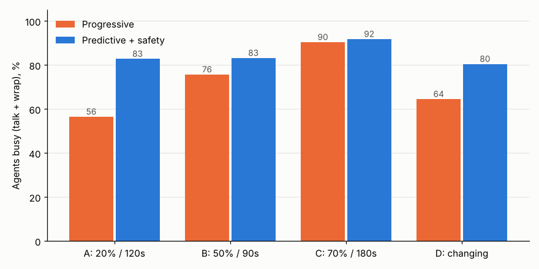
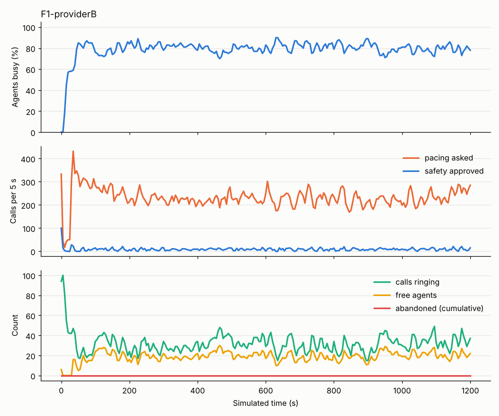
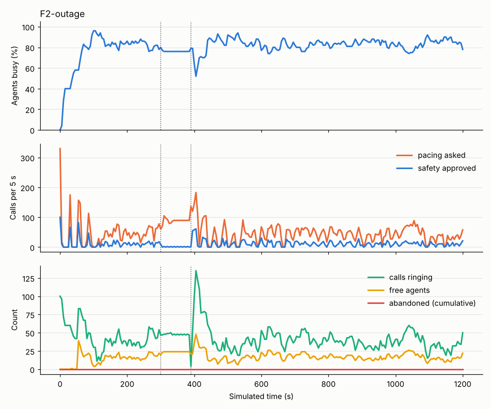
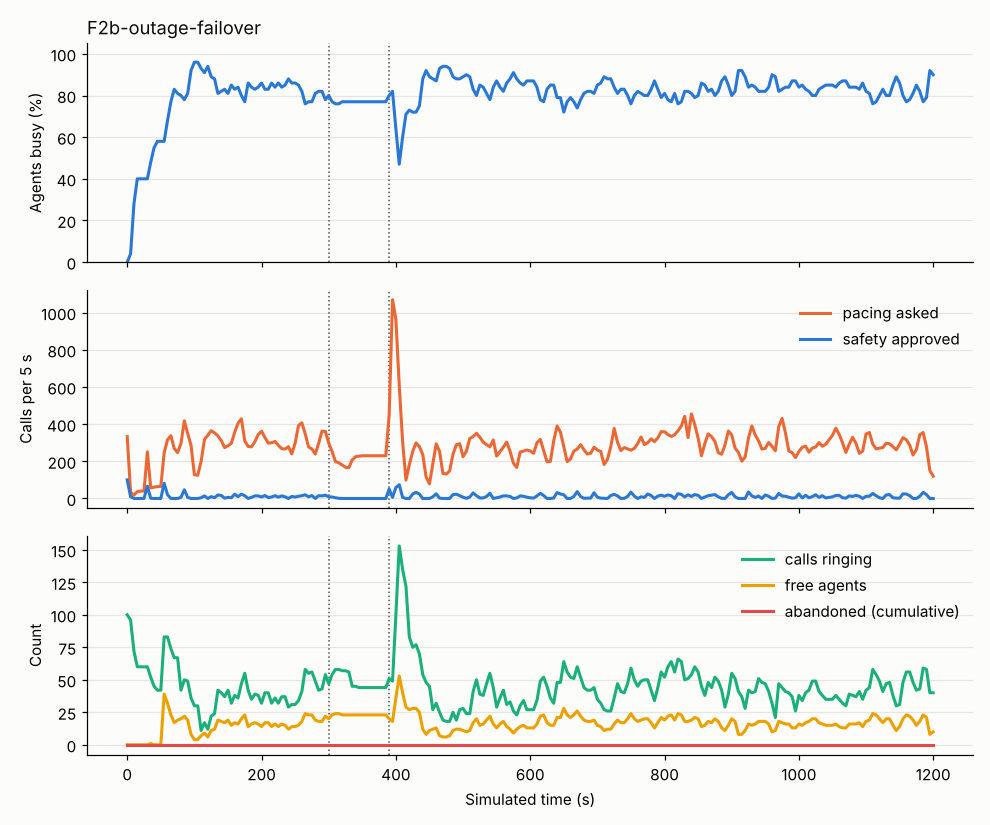
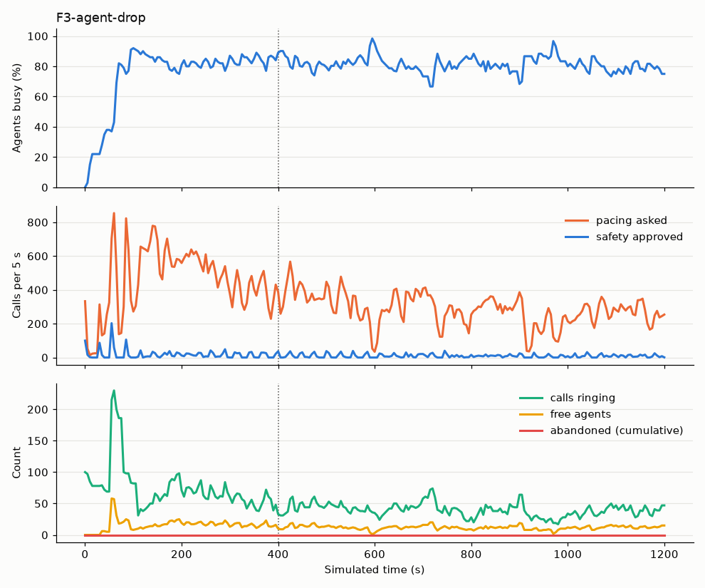
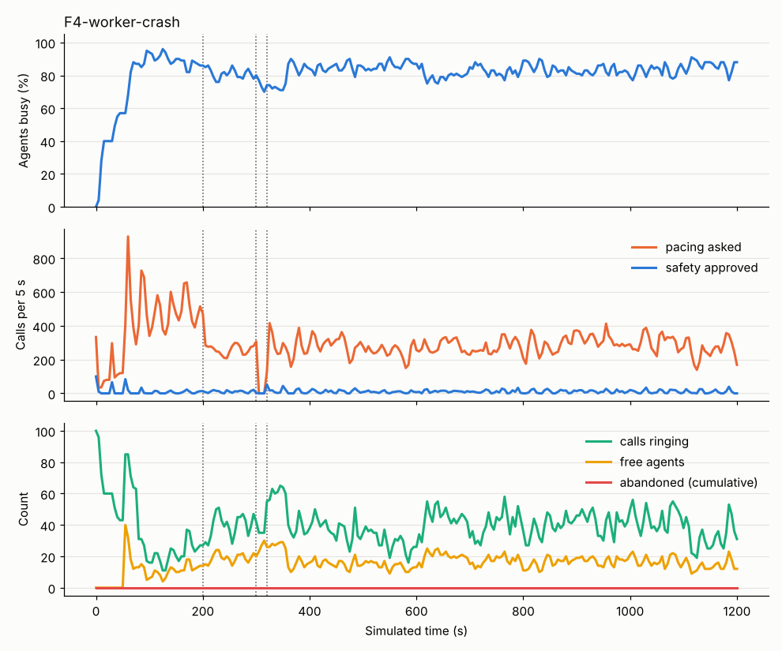
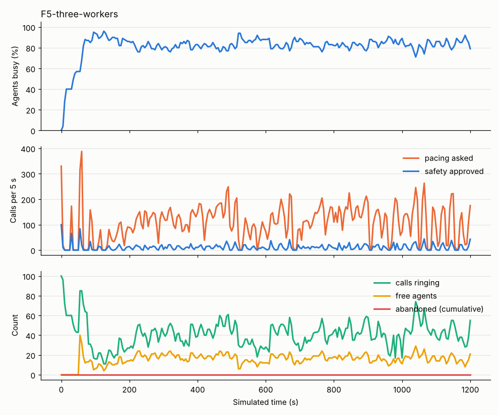
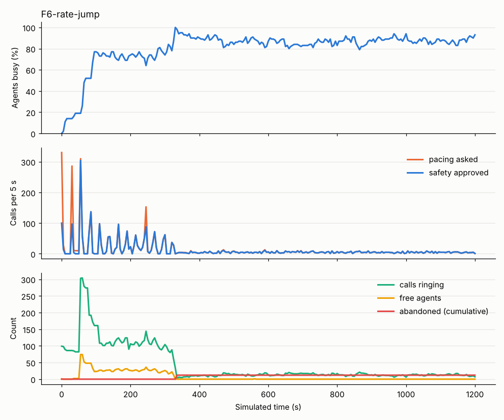
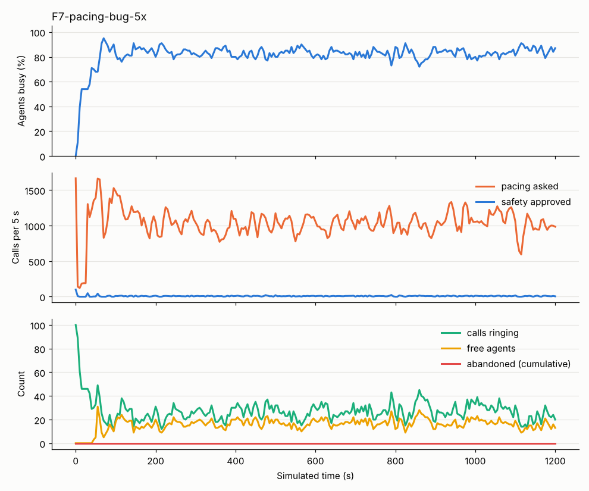

# Simulation results

Output of `python -m sim.run`. 100 agents, provider A unless stated, 1 pacing decision per worker per second, 20 simulated minutes. Utilisation averages skip the first 120 s. Busy = talk + wrap-up share of staffed agents. Safety columns count decisions: Approved / Reduced / Rejected / Fallback-to-progressive.

## Progressive vs predictive

| Run | Busy | Talk | Initiated | Connected | Abandoned | Cancelled | Connects/agent-hr | Safety A/Red/Rej/FB | Invariants |
|---|---|---|---|---|---|---|---|---|---|
| A-prog | 56.5% | 52.2% | 2708 | 532 | 0 (0.00%) | 0 | 15.96 | 1201/0/0/0 | OK |
| A-pred | 82.8% | 76.2% | 3920 | 780 | 0 (0.00%) | 20 | 23.4 | 0/530/640/31 | OK |
| B-prog | 75.7% | 68.0% | 1889 | 924 | 0 (0.00%) | 0 | 27.72 | 1201/0/0/0 | OK |
| B-pred | 83.2% | 74.7% | 2053 | 1028 | 0 (0.00%) | 6 | 30.84 | 0/723/447/31 | OK |
| C-prog | 90.4% | 85.3% | 940 | 636 | 0 (0.00%) | 0 | 19.08 | 1201/0/0/0 | OK |
| C-pred | 91.8% | 86.6% | 934 | 655 | 0 (0.00%) | 0 | 19.65 | 0/508/662/31 | OK |
| D-prog | 64.5% | 59.9% | 2347 | 534 | 0 (0.00%) | 0 | 16.02 | 1201/0/0/0 | OK |
| D-pred | 80.5% | 74.6% | 3818 | 694 | 0 (0.00%) | 37 | 20.82 | 0/663/507/31 | OK |



## Failure and stress runs (predictive mode)

| Run | Busy | Talk | Initiated | Connected | Abandoned | Cancelled | Connects/agent-hr | Safety A/Red/Rej/FB | Invariants |
|---|---|---|---|---|---|---|---|---|---|
| F1-providerB | 80.3% | 72.0% | 1959 | 993 | 0 (0.00%) | 17 | 29.79 | 0/744/426/31 | OK |
| F2-outage | 82.3% | 75.6% | 2565 | 787 | 0 (0.00%) | 30 | 23.61 | 0/586/584/31 | OK |
| F2b-outage-failover | 82.4% | 76.0% | 2676 | 768 | 0 (0.00%) | 28 | 23.04 | 0/558/612/31 | OK |
| F3-agent-drop | 81.7% | 75.2% | 3079 | 568 | 0 (0.00%) | 56 | 17.04 | 0/504/666/31 | OK |
| F4-worker-crash | 83.3% | 76.5% | 2576 | 814 | 0 (0.00%) | 30 | 24.42 | 0/578/742/62 | OK |
| F5-three-workers | 83.4% | 76.8% | 2676 | 786 | 0 (0.00%) | 21 | 23.58 | 0/621/2889/93 | OK |
| F6-rate-jump | 84.9% | 78.2% | 2785 | 792 | 12 (1.49%) | 59 | 23.76 | 3/139/160/899 | OK |
| F7-pacing-bug-5x | 83.2% | 74.7% | 2053 | 1028 | 0 (0.00%) | 6 | 30.84 | 0/723/447/31 | OK |

### F1-providerB

- events: {"applied": 4864, "duplicate": 42, "stale": 31, "after_terminal": 76}, exact duplicates dropped at inbox: 794
- allocator: {"placed": 1959, "provider_error": 71, "provider_timeout": 107}
- housekeeping: {"recovered": 29, "reconciled_failed": 51, "stale_closed": 5}
- circuit trips: {"B": 0}, late connects (>2 s): 78
- log: []



### F2-outage

- events: {"applied": 5736, "after_terminal": 38}, exact duplicates dropped at inbox: 0
- allocator: {"placed": 2565, "provider_error": 13, "provider_timeout": 14, "no_provider": 8}
- housekeeping: {"reconciled_failed": 12}
- circuit trips: {"A": 9}, late connects (>2 s): 3
- log: [{"t": 300.0, "fault": "outage", "arg": "('A', True)"}, {"t": 390.0, "fault": "outage", "arg": "('A', False)"}]



### F2b-outage-failover

- events: {"applied": 5961, "after_terminal": 35, "duplicate": 1}, exact duplicates dropped at inbox: 1
- allocator: {"placed": 2676, "provider_error": 20, "provider_timeout": 8}
- housekeeping: {"reconciled_failed": 7}
- circuit trips: {"A": 2, "B": 0}, late connects (>2 s): 4
- log: [{"t": 300.0, "fault": "outage", "arg": "('A', True)"}, {"t": 390.0, "fault": "outage", "arg": "('A', False)"}]



### F3-agent-drop

- events: {"applied": 6581, "after_terminal": 58}, exact duplicates dropped at inbox: 0
- allocator: {"placed": 3079, "provider_error": 13, "provider_timeout": 6}
- housekeeping: {"reconciled_failed": 3}
- circuit trips: {"A": 0}, late connects (>2 s): 0
- log: [{"t": 400.0, "fault": "agents_drop", "arg": "40"}]



### F4-worker-crash

- events: {"applied": 5826, "after_terminal": 30}, exact duplicates dropped at inbox: 0
- allocator: {"placed": 2576, "provider_error": 14, "provider_timeout": 4}
- housekeeping: {"reconciled_failed": 3}
- circuit trips: {"A": 0}, late connects (>2 s): 4
- log: [{"t": 200.0, "fault": "crash_worker", "arg": "('w1', 'after_dial')"}, {"t": 200.0, "crash": "w1 crashed at after_dial (87618c1f)"}, {"t": 300.0, "fault": "crash_worker", "arg": "('w2', 'after_reserve')"}, {"t": 301.0, "crash": "w2 crashed at after_reserve (94e02620)"}, {"t": 320.0, "fault": "restart_worker", "arg": "w1"}]



### F5-three-workers

- events: {"applied": 5983, "after_terminal": 21}, exact duplicates dropped at inbox: 0
- allocator: {"placed": 2676, "provider_error": 11, "provider_timeout": 4}
- housekeeping: {"reconciled_failed": 3}
- circuit trips: {"A": 0}, late connects (>2 s): 0
- log: []



### F6-rate-jump

- events: {"applied": 6207, "after_terminal": 71}, exact duplicates dropped at inbox: 0
- allocator: {"placed": 2785, "provider_error": 11, "provider_timeout": 4}
- housekeeping: {"abandoned": 12, "reconciled_failed": 2}
- circuit trips: {"A": 0}, late connects (>2 s): 0
- log: []



### F7-pacing-bug-5x

- events: {"applied": 5034, "after_terminal": 7}, exact duplicates dropped at inbox: 0
- allocator: {"placed": 2053, "provider_error": 4, "provider_timeout": 6}
- housekeeping: {"reconciled_failed": 1, "stale_closed": 1}
- circuit trips: {"A": 0}, late connects (>2 s): 0
- log: []



## Agent drop: reaction trace (t = 398..404)

```
t=398 REDUCED   asked=89   approved=12  cancel=0   free=18 unbacked=43 overflow bound: p_hi=0.256, eps=1.500% allows 55 in flight for 18 agents
t=399 REDUCED   asked=79   approved=2   cancel=0   free=17 unbacked=50 overflow bound: p_hi=0.253, eps=1.500% allows 52 in flight for 17 agents
t=400 REJECTED  asked=32   approved=0   cancel=16  free=10 unbacked=49 shock (9 agents left in 30s): 49 unbacked > safe 33 for 10 free agents; cancel 16; overflow bound: p_hi=0.259, eps=1.500% allows 26 in flight for 10 agents
t=401 REJECTED  asked=48   approved=0   cancel=0   free=10 unbacked=33 overflow bound: p_hi=0.259, eps=1.500% allows 26 in flight for 10 agents
t=402 REJECTED  asked=52   approved=0   cancel=0   free=11 unbacked=33 overflow bound: p_hi=0.253, eps=1.500% allows 30 in flight for 11 agents
t=403 REJECTED  asked=53   approved=0   cancel=0   free=10 unbacked=32 overflow bound: p_hi=0.256, eps=1.500% allows 27 in flight for 10 agents
t=404 REJECTED  asked=53   approved=0   cancel=0   free=10 unbacked=32 overflow bound: p_hi=0.256, eps=1.500% allows 27 in flight for 10 agents
```

## Answer rate 10% -> 70% at t=300: safety's estimate (t = 298..312)

```
t=298 REDUCED   asked=227  approved=9   p_hi=0.1547 floor=0.069 shift=False free=24 unbacked=87 cancel=0
t=300 REDUCED   asked=232  approved=12  p_hi=0.152 floor=0.0741 shift=False free=26 unbacked=92 cancel=0
t=302 REJECTED  asked=181  approved=0   p_hi=0.1547 floor=0.0462 shift=False free=24 unbacked=100 cancel=0
t=304 REJECTED  asked=187  approved=0   p_hi=0.152 floor=0.0732 shift=False free=23 unbacked=97 cancel=0
t=306 REJECTED  asked=171  approved=0   p_hi=0.152 floor=0.0976 shift=False free=22 unbacked=94 cancel=0
t=308 REJECTED  asked=146  approved=0   p_hi=0.152 floor=0.1382 shift=False free=18 unbacked=89 cancel=0
t=310 REJECTED  asked=95   approved=0   p_hi=0.1707 floor=0.1707 shift=False free=16 unbacked=85 cancel=0
t=312 REJECTED  asked=84   approved=0   p_hi=0.1789 floor=0.1789 shift=False free=17 unbacked=84 cancel=0
```

## Why this many calls? One decision, end to end

Scenario B, t=401s.

Pacing engine (expected value):

```
{
 "p_hat": 0.52,
 "free_agents": 20,
 "soon_free": 16.12,
 "capacity": 36.12,
 "in_flight_unbacked": 25,
 "expected_answers_in_flight": 13.0,
 "deficit": 23.12,
 "ring_s": 8.3,
 "talk_s": 96.2,
 "formula": "floor(aggr * (capacity - in_flight*p) / p)"
}
```

Safety controller (its own numbers, read inside its transaction):

```
{
 "abandon_rate": 0.0,
 "abandon_denominator": 358,
 "free_agents": 20,
 "unbacked_in_flight": 25,
 "progressive_capacity": 0,
 "answered_waiting": 0,
 "stale_agents": 0,
 "p_hi": 0.5682,
 "p_hi_long": 0.5682,
 "p_hi_short": 0.6259,
 "shift": false,
 "p_floor_recent": 0.3529,
 "eps": 0.015,
 "provider_allowance": "unlimited",
 "cap": 20,
 "max_inflight_stat": 30,
 "max_inflight_hard": 80,
 "room": 5,
 "exp_overflow": 0.178,
 "exp_connects": 16.87,
 "agent_bound_first": 0
}
```

Verdict **REDUCED**: asked 44, approved 5. Reasons: overflow bound: p_hi=0.568, eps=1.500% allows 30 in flight for 20 agents
