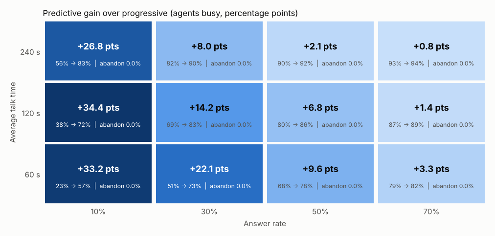

# Sweep: where predictive pacing pays off

Output of `python -m sim.sweep`. Same setup as `docs/RESULTS.md`: 100 agents, provider A, 20 simulated minutes per run, utilisation averaged after the first 120 s. Each cell runs progressive and predictive with the same seed. Busy = talk + wrap-up share of staffed agents. Abandon rate = abandoned / (connected + abandoned).

| Answer rate | Talk | Progressive busy | Predictive busy | Gain (pts) | Connects/agent-hr (prog -> pred) | Abandoned (rate) | Cancelled | Invariants |
|---|---|---|---|---|---|---|---|---|
| 10% | 60 s | 23.4% | 56.6% | +33.2 | 12.57 -> 29.34 | 0 (0.00%) | 61 | OK |
| 30% | 60 s | 51.3% | 73.4% | +22.1 | 27.0 -> 38.16 | 0 (0.00%) | 99 | OK |
| 50% | 60 s | 68.3% | 77.9% | +9.6 | 35.85 -> 40.32 | 0 (0.00%) | 23 | OK |
| 70% | 60 s | 78.8% | 82.1% | +3.3 | 41.91 -> 42.81 | 0 (0.00%) | 8 | OK |
| 10% | 120 s | 37.5% | 71.9% | +34.4 | 10.56 -> 20.22 | 0 (0.00%) | 79 | OK |
| 30% | 120 s | 69.1% | 83.3% | +14.2 | 20.19 -> 23.46 | 0 (0.00%) | 34 | OK |
| 50% | 120 s | 79.7% | 86.5% | +6.8 | 22.8 -> 24.81 | 0 (0.00%) | 4 | OK |
| 70% | 120 s | 87.2% | 88.6% | +1.4 | 25.65 -> 26.13 | 0 (0.00%) | 0 | OK |
| 10% | 240 s | 55.9% | 82.7% | +26.8 | 8.61 -> 12.75 | 0 (0.00%) | 17 | OK |
| 30% | 240 s | 82.0% | 90.0% | +8.0 | 13.02 -> 14.1 | 0 (0.00%) | 3 | OK |
| 50% | 240 s | 89.5% | 91.6% | +2.1 | 14.43 -> 14.7 | 0 (0.00%) | 2 | OK |
| 70% | 240 s | 92.8% | 93.6% | +0.8 | 15.57 -> 14.91 | 0 (0.00%) | 0 | OK |

Highest predictive abandon rate across the grid: 0.00% (answer rate 10%, talk 60 s). Breaker trip threshold: 2.5%.

## Clustered borrower segments

Segments: 30% of borrowers answer 60% (150 s talk), 50% answer 25% (120 s), 20% answer 5% (60 s); campaign average ~31%. Shuffled: segments mixed randomly through the queue. Block N: the queue alternates runs of N borrowers from one segment, so the answer rate of consecutive dialing bursts jumps between 5% and 60%. Two seeds per row.

| Queue | Seed | Busy | Connected | Abandoned (rate) | Cancelled | Invariants |
|---|---|---|---|---|---|---|
| shuffled | 7 | 85.3% | 741 | 0 (0.00%) | 14 | OK |
| shuffled | 11 | 85.0% | 731 | 0 (0.00%) | 6 | OK |
| blocks of 10 | 7 | 83.6% | 739 | 0 (0.00%) | 53 | OK |
| blocks of 10 | 11 | 83.6% | 744 | 0 (0.00%) | 47 | OK |
| blocks of 25 | 7 | 83.7% | 731 | 0 (0.00%) | 164 | OK |
| blocks of 25 | 11 | 83.1% | 752 | 0 (0.00%) | 207 | OK |
| blocks of 100 | 7 | 83.0% | 716 | 2 (0.28%) | 123 | OK |
| blocks of 100 | 11 | 81.9% | 727 | 6 (0.82%) | 59 | OK |
| blocks of 200 | 7 | 81.0% | 725 | 0 (0.00%) | 90 | OK |
| blocks of 200 | 11 | 81.0% | 706 | 0 (0.00%) | 73 | OK |

### Blocks of 100, 11 seeds

| Seed | 1 | 2 | 3 | 4 | 5 | 6 | 7 | 8 | 9 | 10 | 11 |
|---|---|---|---|---|---|---|---|---|---|---|---|
| Abandoned | 8 | 7 | 0 | 16 | 0 | 6 | 2 | 30 | 0 | 2 | 6 |
| Rate | 1.35% | 1.09% | 0.00% | 2.24% | 0.00% | 0.84% | 0.28% | 4.17% | 0.00% | 0.28% | 0.82% |

Median 0.82%, maximum 4.17%; 1 of 11 runs above 3%.
